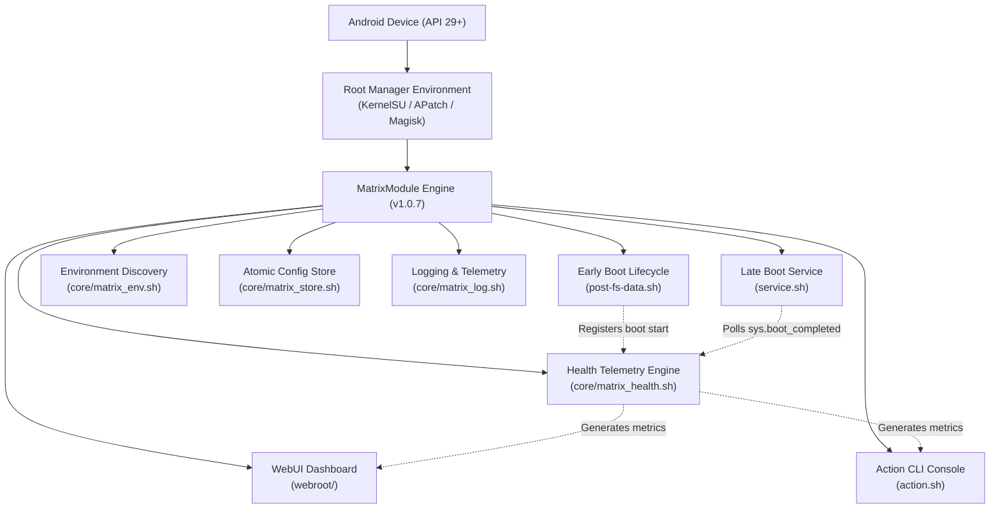

<div align="center">

# MatrixModule

**Unified KernelSU Management, Diagnostics & Telemetry Framework**

[](https://github.com/mengalpratik/MatrixModule/releases/tag/v1.0.7)
[-success.svg)](#root-manager-compatibility)
[](#root-manager-compatibility)
[-brightgreen.svg)](#testing--verification)
[](#repository-status)

</div>

---

## 1. Project Overview

**MatrixModule** is a clean-room, production-grade root framework engineered for modern Android environments. It synthesizes architectural paradigms from leading root modules into a unified, transparent, and non-destructive management and diagnostics layer.

The project provides unified environment discovery, atomic state and configuration management, honest four-state health telemetry, structured logging with logcat bridging, and an interactive dual-interface management layer (KernelSU WebUI and terminal Action Console).

> [!IMPORTANT]
> **Physical Device Testing Notice:**  
> MatrixModule v1.0.7 has undergone comprehensive static analysis, syntax verification, mock boot simulation, and round-trip verification across **12 automated test suites (100% pass rate)**. However, **physical device validation on physical hardware has not yet been performed**. Users must test in controlled environments with verified recovery access.

---

## 2. Main Features

* **Universal Root Discovery:** Probes KernelSU, APatch, and Magisk runtime environments dynamically without hardcoded paths or destructive assumptions.
* **Honest Health Telemetry:** Four-tier status engine (`HEALTHY`, `WARNING`, `ERROR`, `UNKNOWN`) governed by strict mathematical precedence rules. Never hides boot timeouts or module conflicts behind a false healthy badge.
* **Deterministic Boot Lifecycle:** Early boot registration ([`post-fs-data.sh`](post-fs-data.sh)) and late boot monitoring ([`service.sh`](service.sh)) with a 300-second timeout boundary and post-loop completion verification.
* **Atomic Configuration Store:** Crash-resilient key-value configuration engine with regex validation, automatic backups (`config.bak`), and self-healing restore procedures.
* **Zero-Dependency WebUI & Action Console:** Responsive dark-mode dashboard compatible with the native KernelSU JavaScript bridge (`ksu.exec`) and standalone desktop browsers, paired with an interactive ASCII Action console.
* **Strict Phase 4 Security Boundaries:** Defensive architecture that operates strictly in safe coexistence mode. Contains zero attestation forgery, zero private keyboxes, zero DroidGuard interception, and zero package cloaking.

---

## 3. Architecture Overview

MatrixModule cleanly separates early boot initialization, late background services, core helper subsystems, and presentation interfaces:



---

## 4. Root Manager Compatibility

| Environment | Supported Versions | Status | Integration Details |
| :--- | :--- | :--- | :--- |
| **KernelSU** | Recommended v0.6.7+ (code 10670+) | Full Support | Native WebUI bridge, Action button interface, driver/manager version tracking. |
| **APatch** | API 29+ | Full Support | Standard module packaging, CLI diagnostics, dynamic root detection. |
| **Magisk** | v24.0+ | Compatible | Magisk module loader compatibility, update-binary abstraction. |

---

## 5. Zygisk Dependency Clarification

> [!NOTE]
> **Zygisk is NOT required for MatrixModule.**  
> **Do not enable Zygisk solely to install or operate MatrixModule.**

In [`core/matrix_env.sh`](core/matrix_env.sh#L60-L85), `matrix_check_zygisk()` performs a non-destructive read-only scan of `/data/adb/modules/` and Magisk SQLite settings to detect if a third-party Zygisk provider (e.g. Zygisk Next or Magisk Zygisk) is active.

MatrixModule:
1. Does **not** require Zygisk to install, execute, or report health.
2. Does **not** inject libraries into `zygote`.
3. Does **not** install a Zygisk payload.
4. Does **not** enable, disable, or modify Zygisk settings for any other module.

---

## 6. Installation & Operation

> [!IMPORTANT]
> **INSTALL FROM ROOT MANAGER APP ONLY — DO NOT FLASH IN RECOVERY**  
> For detailed instructions, prerequisites, first-boot checks, and conservative recovery procedures, see the comprehensive [Installation, Operation & Recovery Guide](docs/INSTALLATION_GUIDE.md).

### Quick Installation:
1. Download [`MatrixModule-v1.0.7.zip`](https://github.com/mengalpratik/MatrixModule/releases/tag/v1.0.7) and verify its SHA-256:
   ```text
   b217bb84a03ef6f19f61fd8f68607fc305327a57883e4d6847d03d3850b7e5d3
   ```
2. Open your root manager application (KernelSU, APatch, or Magisk).
3. Navigate to **Modules** $\rightarrow$ **Install from Storage**.
4. Select `MatrixModule-v1.0.7.zip` and review installer output.
5. Reboot when prompted.

---

## 7. Health Status Guide

MatrixModule assesses system health using an explicit four-tier state machine:

$$\text{ERROR} > \text{UNKNOWN} > \text{WARNING} > \text{HEALTHY}$$

* **`HEALTHY` (Green):** Android boot stage strictly `completed`, all system environment probes verified, zero conflicting modules detected.
* **`WARNING` (Yellow/Amber):** Non-fatal condition detected: boot completion wait timeout (300s), active overlapping third-party module detected, or KernelSU manager/driver code mismatch.
* **`ERROR` (Red):** Critical failure: active recovery mode detected, boot failure recorded, or unsupported architecture.
* **`UNKNOWN` (Grey/Blue):** Indeterminate state: missing state file, unresolvable root manager, unresolvable SELinux mode, or unresolvable SDK level.

---

## 8. Security Boundaries

MatrixModule operates under strict Phase 4 defensive programming boundaries:
* **Zero Attestation Forgery:** Never hooks Keymaster/KeyMint HAL, tampers with X.509 certificate chains, or forges hardware root-of-trust.
* **Zero Keybox Integration:** Never extracts, stores, or bundles unauthorized OEM private keys.
* **Zero Play Integrity Bypass:** Never spoofs DroidGuard verdicts or Google Play Services communications.
* **Zero Package Cloaking:** Never hooks `PackageManagerService` to hide installed applications.
* **Safe Coexistence Mode:** Scans for third-party modules non-destructively; never disables or removes other modules.

---

## 9. Documentation Index

| Document | Purpose |
| :--- | :--- |
| **[docs/INSTALLATION_GUIDE.md](docs/INSTALLATION_GUIDE.md)** | Step-by-step installation, Zygisk clarification, recovery, and updates. |
| **[docs/ARCHITECTURE.md](docs/ARCHITECTURE.md)** | Comprehensive component architecture, data flows, and state management. |
| **[docs/BOOT_SEQUENCE.md](docs/BOOT_SEQUENCE.md)** | Sequence analysis of early post-fs-data and late service initialization. |
| **[docs/COMPATIBILITY.md](docs/COMPATIBILITY.md)** | Root manager matrix, Android versions, SELinux policies, and OEM notes. |
| **[docs/SECURITY.md](docs/SECURITY.md)** | Defensive programming principles, input sanitization, and security rules. |
| **[docs/BUILD.md](docs/BUILD.md)** | Build instructions, directory permissions, and packaging pipelines. |
| **[docs/CHANGELOG.md](docs/CHANGELOG.md)** | Version milestone history from v1.0.0 through v1.0.7. |
| **[docs/V1.0.7_REMEDIATION_REPORT.md](docs/V1.0.7_REMEDIATION_REPORT.md)** | Milestone 9 technical remediation report and verification proofs. |

---

## 10. Testing & Verification

The project includes **12 specialized test suites** executed via [`tests/run_all_tests.sh`](tests/run_all_tests.sh):

```text
==================================================
                  Test Summary                    
==================================================
 Total Suites: 12
 Passed:       12
 Failed:       0
 Status:       ALL TESTS PASSED (100%)
==================================================
```

1. `test_syntax.sh`: Shell script syntax validation (`sh -n`).
2. `test_structure.sh`: Directory and `module.prop` metadata verification.
3. `test_permissions.sh`: Strict octal permissions (`0755` / `0644`).
4. `test_packaging.sh`: Packaging integrity and exclusion boundary validation.
5. `test_js_syntax.sh`: WebUI JavaScript syntax and strict mode compliance.
6. `test_config_store.sh`: Atomic configuration store CRUD, backups, and restores.
7. `test_boot_mock.sh`: Mock boot lifecycle, boundary tests A–D, and log-init failure handling.
8. `test_uninstall_boundaries.sh`: Safe uninstallation and config backup preservation.
9. `test_installer_failures.sh`: 37 failure tests (special bits rejection, missing file fatal checks).
10. `test_webui_api.sh`: Node.js VM bridge execution, async callbacks, and desktop simulation.
11. `test_action_dynamic.sh`: Dynamic paths, space handling, and KSU mismatch displays.
12. `test_json_roundtrip.sh`: 24 JSON escaping round-trip oracle tests with BusyBox parity.

---

## 11. Uninstallation

Uninstalling through the root manager invokes [`uninstall.sh`](uninstall.sh):
* **Removed:** `/data/adb/modules/matrix_module`, runtime state (`state`), health report (`health.json`), logs (`logs/`), and active configuration (`config`).
* **Preserved:** Configuration backup (`/data/adb/matrix_module/config.bak`) is safely retained for future re-installations.

To completely wipe all data:
```bash
rm -rf /data/adb/matrix_module
```

---

## 12. Repository Status & License

* **Visibility:** Private Repository.
* **Target:** KernelSU Unified Module Framework.
* **License Notice:** All rights reserved. Do not redistribute or publish without authorization.
