# MatrixModule Boot Sequence & Execution Lifecycle

## 1. Boot Stages Overview

MatrixModule hooks into the three canonical Android / KernelSU boot phases:
1. **`post-fs-data` Stage**: Executes synchronously before Zygote initialises.
2. **`service` Stage**: Executes asynchronously in the background as a late service.
3. **`boot-completed` Event**: Finalizes telemetry once Android framework reports `sys.boot_completed=1`.

```mermaid
sequenceDiagram
    autonumber
    participant Init as Android init
    participant KSU as KernelSU Core
    participant PFD as post-fs-data.sh
    participant ZYG as app_process (Zygote)
    participant SVC as service.sh
    participant WDG as Watchdog Loop (Background)
    participant KSUM as KernelSU Manager (User UI)

    Note over Init,KSU: Device Power-on & Kernel Initialisation
    Init->>KSU: Mounts /data & calls post-fs-data scripts
    KSU->>PFD: Executes MatrixModule/post-fs-data.sh
    PFD->>PFD: matrix_store_init (verifies /data/adb/matrix_module)
    PFD->>PFD: matrix_health_mark_boot_start
    PFD->>PFD: matrix_cfg_backup (refreshes config.bak)
    PFD-->>KSU: Exits cleanly (0) without blocking init

    Init->>ZYG: Starts Zygote & System Services
    KSU->>SVC: Spawns MatrixModule/service.sh (Background)
    
    rect rgb(20, 30, 45)
        Note over SVC: Waiting for Framework Ready
        loop Until sys.boot_completed == 1
            SVC->>SVC: sleep 2 (bounded max 300s)
        end
    end

    SVC->>SVC: matrix_health_mark_boot_complete (calculates duration)
    SVC->>SVC: matrix_scan_conflicts (non-destructive check)
    SVC->>SVC: Writes /data/adb/matrix_module/health.json
    SVC->>WDG: Forks background health check loop (if enabled)

    Note over KSUM: User opens KernelSU Manager
    KSUM->>SVC: Reads module.prop & WebUI (webroot/)
    KSUM->>SVC: Taps [Action] -> runs action.sh (Diagnostics Dump)
```

---

## 2. Stage-by-Stage Breakdown

### 2.1 Early Boot: `post-fs-data.sh`
- **Execution Condition**: Invoked by KernelSU while `/data` is writable but before Zygote spawns.
- **Actions**:
  1. Sources `core/matrix_log.sh`, `core/matrix_store.sh`, and `core/matrix_health.sh`.
  2. Ensures `/data/adb/matrix_module` permissions are secure (`0700`).
  3. Checks `ro.boot.mode`: If the device is in recovery/rescue mode, skips background setup to prevent bootloop aggravation.
  4. Records the epoch timestamp as `boot_start_time` in `/data/adb/matrix_module/state`.
  5. Refreshes the configuration backup (`config.bak`) if `backup_on_boot=1`.
  6. Exits immediately with return code `0`.
- **Safety Guarantee**: Does not perform disk writes to `/system`, does not invoke network calls, does not execute blocking loops.

### 2.2 Late Boot: `service.sh`
- **Execution Condition**: Executed in a detached subshell once early init finishes.
- **Actions**:
  1. Polls `getprop sys.boot_completed` in 2-second intervals.
  2. Implements a 300-second hard ceiling: if the property is never asserted (e.g. headless setups), the service proceeds rather than hanging indefinitely.
  3. Computes the total elapsed boot duration (`boot_duration_sec = current_time - boot_start_time`).
  4. Runs `matrix_scan_conflicts` to inventory coexisting modules.
  5. Exports a standardized telemetry JSON payload to `/data/adb/matrix_module/health.json`.
  6. If `health_watchdog_enabled=1`, forks a lightweight background loop that re-evaluates system health every `watchdog_interval_sec` (default 300s).

### 2.3 Interactive Execution: `action.sh`
- **Execution Condition**: Triggered on-demand when the user presses the "Action" button in KernelSU Manager, or executes `sh /data/adb/modules/matrix_module/action.sh` in a root shell.
- **Actions**:
  1. Hops into busybox `ash` if available.
  2. Gathers real-time environment metrics (KernelSU version alignment, CPU arch, Android release, SELinux mode, Zygisk presence).
  3. Formats and prints an interactive ASCII diagnostics dashboard.
  4. Supports subcommands: `action.sh logs`, `action.sh reload`, `action.sh selftest`.
