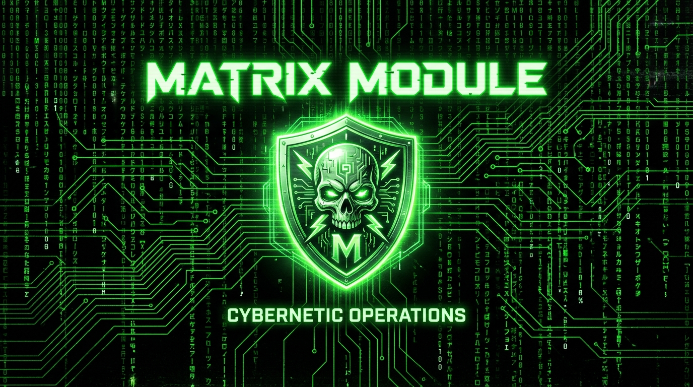
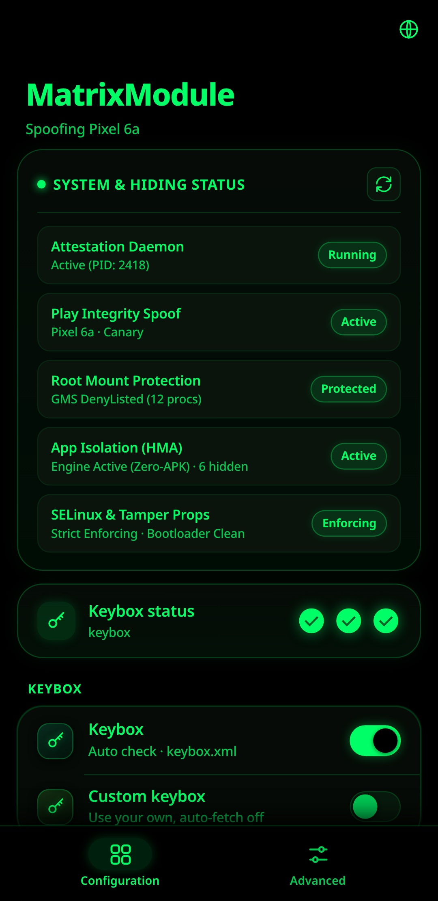
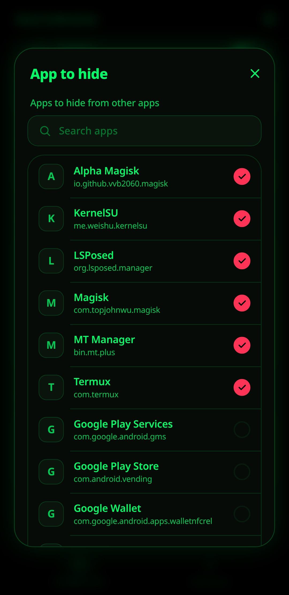
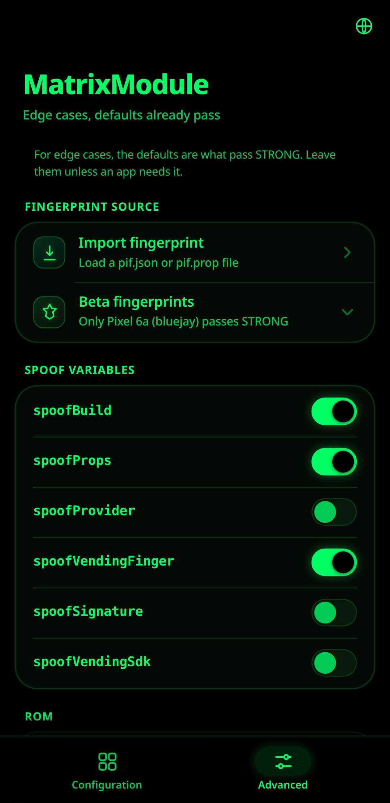
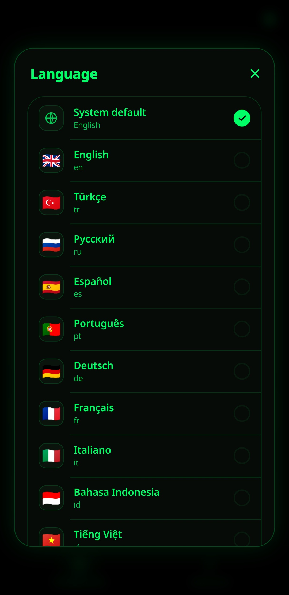

<div align="center">



<br>
<br>

[](LICENSE)
[](CHANGELOG.md)

<p align="center">
   &nbsp;
   &nbsp;
   &nbsp;
  
</p>

<sub>Built-in Pitch-Black Cyber WebUI on KernelSU / APatch: Live System Health Dashboard, Zero-APK Root App Isolation, granular Play Integrity spoofing, translated into 15 languages.</sub>

</div>

# MatrixModule

**The All-In-One Root Cloaking & Play Integrity Suite for Android (Magisk / KernelSU / APatch / SukiSU).**

MatrixModule unifies **Hardware Attestation (`STRONG`)**, **Automated Play Integrity Fingerprint Spoofing**, and **Built-in Zero-APK App Isolation (HMA)** into a single, clean drop-in module. It bundles [TEESimulator-RS](https://github.com/Enginex0/TEESimulator-RS), [PlayIntegrityFork](https://github.com/osm0sis/PlayIntegrityFork), and an integrated headless Zygote hook engine derived from [HMA-OSS](https://github.com/frknkrc44/HMA-OSS) so you get top-tier root cloaking and integrity passing without managing multiple modules, installing manager APKs, or dealing with manual wiring.

To use this module you need one of the following (latest versions), with a Zygisk implementation installed:

- [Magisk](https://github.com/topjohnwu/Magisk) with Zygisk enabled — a standalone [Zygisk Next](https://github.com/Dr-TSNG/ZygiskNext) / [ReZygisk](https://github.com/PerformanC/ReZygisk) / [NeoZygisk](https://github.com/JingMatrix/NeoZygisk) is recommended over Magisk's built-in Zygisk, which is more easily detected
- [KernelSU](https://github.com/tiann/KernelSU) or [SukiSU Ultra](https://github.com/SukiSU-Ultra/SukiSU-Ultra) with [Zygisk Next](https://github.com/Dr-TSNG/ZygiskNext) or [ReZygisk](https://github.com/PerformanC/ReZygisk) or [NeoZygisk](https://github.com/JingMatrix/NeoZygisk) module installed
- [APatch](https://github.com/bmax121/APatch) with [Zygisk Next](https://github.com/Dr-TSNG/ZygiskNext) or [ReZygisk](https://github.com/PerformanC/ReZygisk) or [NeoZygisk](https://github.com/JingMatrix/NeoZygisk) module installed

Android 10+ (SDK 29) is required.

## Installation

1. Install a Zygisk implementation (Zygisk Next / ReZygisk / NeoZygisk).
2. Download the latest ZIP from [Releases](https://github.com/mengalpratik/MatrixModule/releases).
3. Flash it in your root manager and reboot.
4. Open the module and tap **Action** (or configure via the built-in WebUI).
5. Check your verdict with an integrity checker (Play Integrity API Checker, YASNAC, Simple PIC) and root detectors.

The first Action tap fetches a working keybox and a fresh Pixel fingerprint and restarts Play Integrity, so there is no manual keybox step. The installer also removes conflicting standalone modules at install time (TrickyStore, PlayIntegrityFix/Fork, TEESimulator, playcurl/playcurlNEXT, SafetyNet Fix, MagiskHidePropsConf, Tricky Addon, Yurikey, and older separate HMA modules).

### Which build to download

**If you're not sure, download `MatrixModule-<version>.zip` — the plain one with no suffix.** It's the default and passes `STRONG` on most devices.

Every release ships three zips. They differ only in how the Pixel fingerprint is spoofed; all three use the same TEESimulator-RS keystore and the same automated keybox.

| Download | Play Integrity engine | Choose it when |
|---|---|---|
| `MatrixModule-<ver>.zip` | PlayIntegrityFork | **Default — start here.** |
| `MatrixModule-<ver>-inject.zip` | PlayIntegrityFix (inject-s) | The default doesn't reach `STRONG` on your device. |
| `MatrixModule-<ver>-nopif.zip` | **none (Lite)** | The bundled PIF conflicts with Google Play Services (Play Store crashes, "couldn't load" account screen, missing-dependency errors). You keep hardware attestation + the automated keybox, but there is **no fingerprint spoof** — bring your own PlayIntegrityFork / Fix if you need one; the module detects it and keeps it in sync. |

- **Install only one at a time.** Switching builds means flashing the other zip over the top.
- **Auto-update:** all three update themselves in place through your root manager.
- **ABI:** every build installs on arm64-v8a, armeabi-v7a, x86 and x86_64, but PlayIntegrityFix inject-s has no x86 zygisk — on x86 / x86_64 the `-inject` build can't spoof Play Integrity (it says so at install). On x86 use the default or the Lite build.

<details>
<summary><b>Optional keystore engines: TrickyStoreOSS (<code>-TSOSS</code>) and TEESimulator by JingMatrix (<code>-TEESIM</code>)</b></summary>

The keystore half can also run on the open-source [TrickyStoreOSS](https://github.com/beakthoven/TrickyStoreOSS) or on the original [TEESimulator by JingMatrix](https://github.com/JingMatrix/TEESimulator), for any of the three lines above (`-TSOSS`, `-inject-TSOSS`, `-nopif-TSOSS`, `-TEESIM`, `-inject-TEESIM`, `-nopif-TEESIM`). These are **nightly-only, never in a release**: download the latest nightly of each one straight from the [nightly.link table in ADVANCED.md](docs/ADVANCED.md#optional-keystore-engines--tsoss--teesim) (one artifact per variant), or build them yourself with `./build.sh --engine trickystoreoss` / `--engine teesim`. They don't auto-update, and `-TEESIM` is 64-bit only.

Details, caveats (in particular Lite + `-TEESIM`) and how to build them: **[docs/ADVANCED.md](docs/ADVANCED.md)**.

</details>

## Core Features

- **Strict Single Module Architecture.** Shows up cleanly as strictly **ONE single module** (`tricky_store`) in Magisk, KernelSU, or APatch. No phantom secondary modules, no manager clutter.
- **One flash, `STRONG`.** TEESimulator-RS + PlayIntegrityFork merged into a single module. No stacking, no manual wiring.
- **Built-in Zero-APK App Isolation (HMA Engine).** Headless Zygote package-manager hook engine derived from HMA-OSS. Hide root and sensitive apps (Magisk, KernelSU, APatch, LSPosed, Termux, MT Manager, etc.) with automatic root app detection and 1-tap toggles. Zero APKs required on device; configuration is written directly to `/data/misc/hide_my_applist_*` with real-time `system_server` hot-reloading.
- **Live System Health & Hiding Dashboard.** Real-time status cards on the WebUI Configuration tab:
  - 🟢 **Attestation Daemon:** Active supervisor process & PID verification.
  - 🟢 **Play Integrity Spoof:** Live spoof model & Canary identity.
  - 🟢 **Root Mount Protection:** Real-time Magisk DenyList / Shamiko protection count.
  - 🟢 **App Isolation (HMA):** Active headless engine mode & hidden app count.
  - 🟢 **SELinux & Tamper Props:** Strict Enforcing verification & bootloader flag checks.
- **Pure Pitch-Black Matrix WebUI.** Pure `#000000` pitch black background, `#060b07` card surfaces, and `#00ff66` neon accents.
- **Keybox on tap.** The first **Action** fetches a working keybox automatically.
- **A fingerprint that never goes stale.** Every Action pulls a fresh Pixel fingerprint and matching security patch, and a background service does the same **every hour** (interval configurable, each toggle-able from the WebUI).
- **Multi-CDN Mirror Fallback.** Native `asfetch` and shell crawlers automatically fall back across GitHub and jsDelivr CDN mirrors.
- **GMS DroidGuard Recycling (`as_killpi`).** Force-stops DroidGuard (`com.google.android.gms.unstable`) and Play Store on each refresh with `killall -9` fallback for robust Android 15/16/17 binder compatibility.
- **Auto target.** A native watcher follows package changes via inotify: install a new app and it's added to the attestation target instantly.
- **Xposed-aware.** LSPosed / Xposed managers are kept out of the target list, since attesting through a hooked process breaks `STRONG`.
- **Conflict resolution.** Known conflicting modules (TrickyStore, other PIF / TEE forks, SafetyNet Fix, MagiskHidePropsConf, older HMA modules, …) are disabled at install and on every boot.
- **WebUI Advanced tab.** Import your own fingerprint (`pif.json` / `pif.prop`), flip any Play Integrity spoof flag by its real name, add custom target packages, or switch to your own keybox. **Reset to defaults** at the bottom undoes every toggle and re-runs Action, keeping your keybox.

<details>
<summary><b>More: Security-patch sync, one clean module</b></summary>

- **Security-patch sync.** Keeps the OS / vendor / boot security-patch levels reported in attestation aligned with the spoofed fingerprint.
- **One clean module.** PIF and HMA are binary-patched to run inside `tricky_store` — they never litter separate folders under `/data/adb/modules`.
- **Lite builds drive your own PIF.** On a `-nopif` build the Advanced spoof toggles edit a standalone PlayIntegrityFork / PlayIntegrityFix you installed yourself, and its fingerprint is mirrored into the attested identity.

</details>

<details>
<summary><b>About the module: architecture and engine integration</b></summary>

MatrixModule integrates three critical security and integrity components into one cohesive architecture:

1. **TEESimulator-RS** intercepts Binder IPC inside the `keystore2` process and builds full attestation certificate chains from your keybox, so apps that verify hardware key attestation see a legitimate TEE. It is not a fork of TrickyStore; it reuses the same `/data/adb/tricky_store` config layout for drop-in compatibility, but the internals (native Rust certgen, `lsplt` interception, key persistence) are different.
2. **PlayIntegrityFork** injects a `classes.dex` to modify `android.os.Build` fields and hooks native code to spoof system properties, targeting Google Play Services' DroidGuard (Play Integrity).
3. **Headless HMA-OSS Engine** hooks into the Zygote `system_server` package manager service to isolate target apps from discovering root tools, managers, and sensitive packages, completely eliminating the need for `manager.apk`.

TEESimulator's `classes.dex` is renamed to `tee_classes.dex` so it doesn't collide with PIF's, and PIF's hardcoded module paths are binary-patched to point at `/data/adb/modules/tricky_store` — it never creates a separate `playintegrityfix` folder. The module id stays `tricky_store` so existing tooling and root managers keep working unchanged.

</details>

## The Action button

Triggered from your root manager, or by running `sh action.sh` in a root shell. Each tap rebuilds `target.txt`, refreshes the keybox, pulls a fresh Pixel fingerprint and security patch, updates HMA package isolation mappings, and restarts DroidGuard and the Play Store. The verdict updates a few seconds later; no reboot is needed. Every network step is hard-bounded, so a dead network shows "trying with fallback" and the Action still finishes — it never sits on a blank screen.

The same refresh also runs on its own in the background every hour (interval configurable from the WebUI), so the module keeps passing with zero manual upkeep.

## Configuration

Everything lives at `/data/adb/tricky_store/` and is reloaded automatically when changed. The Action button keeps it current, so most users never need to touch any of it.

- **`keybox.xml`** — the attestation keybox, fetched automatically on the first Action tap. To use your own, switch on *Custom keybox* in the WebUI (or place the file here) and it won't be overwritten. To point the auto-refresh at a different mirror, set `KEYBOX_BASE_URL` for `keybox_fetch.sh`; the script validates the payload before replacing the current file.
- **`target.txt`** — apps that receive hardware key attestation and package isolation protection.
- **`alwaysstrong/`** — everything the module itself keeps: `config` (every setting the WebUI writes), `hidden_apps` (apps isolated and hidden via headless HMA), `apps.map` (per-app keybox and mode), `packages`, `state`, `logs/`. Editing `config` by hand works, and deleting it puts every setting back to default.
- **`/data/misc/hide_my_applist_*/`** — synced in real time by MatrixModule WebUI and `hma_sync.sh` to enforce PMS-level package hiding.

## Building

```bash
./build.sh                          # the three release zips (Fork / inject / Lite)
./build.sh --variant fork           # just one line
./build.sh --engine trickystoreoss  # optional: the -TSOSS keystore engine
```

`build.sh` downloads the pinned upstream release ZIPs, overlays the glue scripts in `module/`, and produces the installable ZIPs (on Windows run it from WSL or Git Bash). Engines, repo layout, native binaries and the upstream auto-release: **[docs/ADVANCED.md](docs/ADVANCED.md)**.

## Reproducible builds

Nothing in a release is uploaded by hand: `.github/workflows/release.yml` builds the zips
from the tagged tree on a GitHub runner. The two shipped binaries, `asfetch` and
`aswatcher`, are plain Rust with full source in this repo under `native/asfetch` and
`native/watcher`, not third-party blobs. Rebuild them from the **Native binaries** workflow
on the Actions tab, or locally with `scripts/build-asfetch.sh` and `scripts/build-watcher.sh`.

## Support / Donation

If MatrixModule is useful to you, support the development:

<a href="https://buymeacoffee.com/pratikmengal" target="_blank">
  
</a>

Direct link: [buymeacoffee.com/pratikmengal](https://buymeacoffee.com/pratikmengal)

## Credits

<div align="center">

</div>

MatrixModule stands on the shoulders of the open-source Android root & security research community:

- [frknkrc44](https://github.com/frknkrc44) & [Dr-TSNG](https://github.com/Dr-TSNG) — [HMA-OSS](https://github.com/frknkrc44/HMA-OSS) (Hide My Applist) PMS hook engine and package isolation
- [Evokerr](https://gitlab.com/Evokerr) — [AlwaysStrong](https://gitlab.com/Evokerr/AlwaysStrong) Play Integrity spoofing logic and architecture
- [Enginex0](https://github.com/Enginex0/TEESimulator-RS) — TEESimulator-RS (Rust port, native certgen, AOSP-spec attestation)
- [JingMatrix](https://github.com/JingMatrix/TEESimulator) — original TEESimulator and keystore2 interception
- [5ec1cff](https://github.com/5ec1cff/TrickyStore) — TrickyStore, which pioneered keystore interception and the config-dir layout reused here
- [beakthoven](https://github.com/beakthoven/TrickyStoreOSS) — TrickyStoreOSS, the open-source keystore engine offered as a self-build option
- [osm0sis](https://github.com/osm0sis/PlayIntegrityFork) — PlayIntegrityFork, the maintained fork bundled here
- [chiteroman](https://github.com/chiteroman) — original Play Integrity Fix
- [Displax](https://github.com/Displax/safetynet-fix) — module boot scripts forked into PIF
- [daboynb](https://github.com/daboynb/playcurlNEXT) — fingerprint auto-refresh approach
- [LSPlt](https://github.com/LSPosed/LSPlt) (PLT hooks) and [ring](https://github.com/briansmith/ring) (Rust crypto)
- [KOWX712](https://github.com/KOWX712) — PlayIntegrityFix (inject-s), used by the `-inject` build, and KsuWebUIStandalone

Author & Maintenance: **Pratik Mengal** ([@mengalpratik](https://github.com/mengalpratik))

## Copyright & License

Copyright (c) 2026 Pratik Mengal. All rights reserved.

Licensed under GPL-3.0. MatrixModule bundles TEESimulator-RS (GPL-3.0) and HMA-OSS components (GPL-3.0), which makes the combined distribution GPL-3.0. See [LICENSE](LICENSE) and the upstream repos for full terms. Provided as-is, with no warranty; `STRONG` depends on a non-revoked hardware keybox, which the module cannot mint for you.
