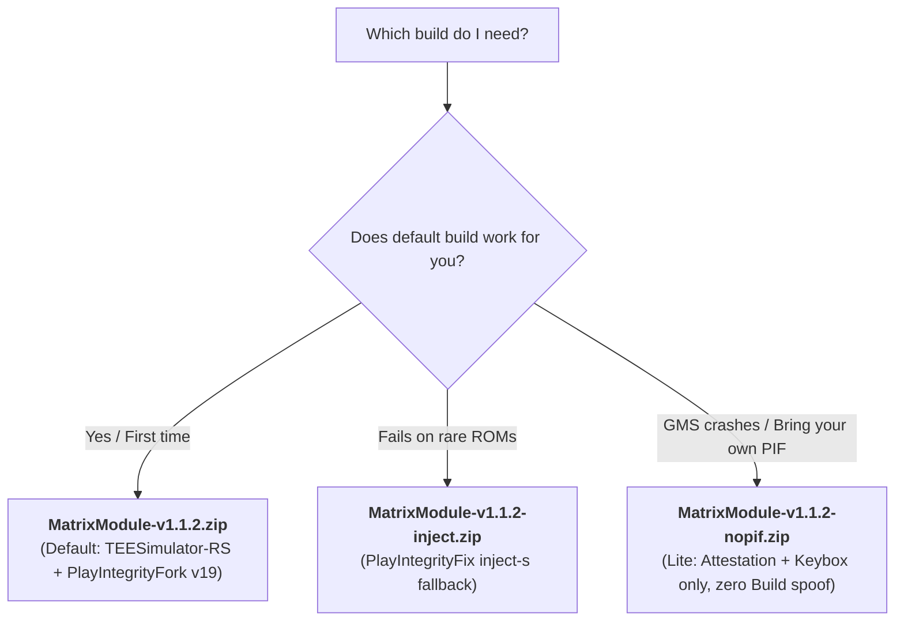

<div align="center">


<br>
<br>

[](LICENSE)
[](CHANGELOG.md)
[](https://android.com)
[](https://developer.android.com/google/play/integrity)

<p align="center">
   &nbsp;
   &nbsp;
   &nbsp;
  
</p>

<sub><b>Pitch-Black Cyber WebUI</b> on KernelSU / APatch / Magisk: Live System Health & Root Protection Dashboard, Zero-APK Headless App Isolation, Granular Play Integrity Spoofing, translated into 15 languages.</sub>

</div>

---

# MatrixModule

> **Why install 5 different modules, 3 companion APKs, and sacrifice your weekend debugging bootloops when you can flash ONE module with Zygisk and be done? ✅ 👍**

**MatrixModule** is the all-in-one, zero-hassle **Root Cloaking & Hardware Attestation Suite** for Android. It unifies **Hardware Attestation (`MEETS_STRONG_INTEGRITY`)**, **Automated Play Integrity Fingerprint Spoofing**, and **Built-in Zero-APK App Isolation (HMA)** into a single, clean drop-in module.

No phantom duplicate folders cluttering your root manager. No conflicting Zygisk hooks crashing your banking apps. No manual keybox hunting every weekend.

---

## ⚡ The "Stack 6 Modules & Pray" Era is Officially Over

If you’ve been rooting Android recently, your module manager probably looks like a chaotic jigsaw puzzle:

| The Old, Painful Way ❌ | The MatrixModule Way ⚡ ✅ |
|---|---|
| Module #1 for Keystore interception (TrickyStore / TEE) | **Single Module Architecture:** Everything lives strictly under `tricky_store`. No duplicate or ghost modules in your manager. |
| Module #2 for Play Integrity Fix / Fork | **Upstream Play Integrity Fork v19:** Built-in dynamic fingerprint spoofing with automatic hourly auto-crawl. |
| Module #3 for Target List generation & watching | **Native Rust Watcher (`aswatcher`):** Real-time `inotify` package watcher using <2.5 MB RAM and 0.0% idle CPU. |
| Module #4 for Hide My Applist (HMA) + companion APK | **Zero-APK Headless HMA Engine:** Hooks PMS directly from Zygote. Hides root managers from target apps with 0 APKs installed! |
| Module #5 for boot-hash & security patch syncing | **Security Patch & VBMeta Engine:** Automatically aligns OS / vendor / boot patch levels with your spoofed fingerprint. |
| Constant manual keybox updating when bans hit | **One-Tap & Hourly Dynamic Keybox Fetch:** Native `asfetch` fetches and validates working keyboxes automatically. |

---

## 📱 Root Manager Compatibility Matrix

MatrixModule is engineered from the ground up to be **100% agnostic** to your rooting solution. Tested and proven across every modern Android root framework:

| Root Manager | Supported Versions | Status | Integration Highlights |
|---|---|:---:|---|
| **KernelSU** | v0.7.0+ / v1.0.0+ | 🟢 **Native** | Full Pitch-Black WebUI directly in manager, Zygisk Next / ReZygisk support, kernel-level unmount. |
| **KernelSU Next** | All releases | 🟢 **Native** | Full WebUI support, dynamic module mounts, automatic app isolation sync. |
| **APatch** | v10.7.0+ (KP) | 🟢 **Native** | Full WebUI support via SuperKey, Zygisk Next / NeoZygisk, seamless SELinux state handling. |
| **APatch Next** | All releases | 🟢 **Native** | Complete integration with APatch Next's enhanced binder hooking. |
| **Magisk (Official)** | v26.0 - v28.0+ | 🟢 **Full** | 1-Tap `Action` button bootstrap, standalone WebUI APK support, ReZygisk / Zygisk Next. |
| **Magisk Alpha** | All recent builds | 🟢 **Full** | Native ash re-execution fallback, mksh-safe subshell execution. |
| **SukiSU Ultra** | All releases | 🟢 **Full** | Full kernel-level hooking + WebUI integration. |
| **Kitsune Mask** | v26.4+ | 🟢 **Full** | Built-in MagiskHide / Sulist co-existence without dual-hook conflicts. |

> [!NOTE]
> **Requirements:** Android 10+ (SDK 29 through Android 16) with any modern Zygisk implementation (**[Zygisk Next](https://github.com/Dr-TSNG/ZygiskNext)** or **[ReZygisk](https://github.com/PerformanC/ReZygisk)** is strongly recommended over legacy built-in Zygisk).

---

## 🚀 Installation: Dead Simple 1-2-3

```
┌────────────────────────────────────────────────────────┐
│  Step 1: Install Zygisk Next or ReZygisk.             │
│  Step 2: Flash MatrixModule-v1.1.2.zip.                │
│  Step 3: Reboot & tap [Action] in your manager.        │
│                                                        │
│  Done! Open any Play Integrity Checker and smile. ✅   │
└────────────────────────────────────────────────────────┘
```

1. **Prerequisite:** Make sure your root manager has a working Zygisk module installed.
2. **Download:** Grab the latest `MatrixModule-v1.1.2.zip` from **[Releases](https://github.com/mengalpratik/MatrixModule/releases)**.
3. **Flash:** Install the ZIP in Magisk, KernelSU, or APatch, then **Reboot**.
4. **Activate:** Open your root manager and tap the **[Action]** button on MatrixModule (or run `su -c "/data/adb/modules/tricky_store/action.sh"` in Termux).
   - *On KernelSU / APatch, you can also launch the WebUI to inspect your live status!*
5. **Verify:** Open *Play Integrity API Checker*, *TB Checker*, or *Simple PIC* — verify `MEETS_BASIC_INTEGRITY`, `MEETS_DEVICE_INTEGRITY`, and `MEETS_STRONG_INTEGRITY`!

---

## 📦 Which Build to Download?

Every release provides three tailored lines. **If you're not sure, grab the default:**



| Download Package | Play Integrity Engine | Hardware Keystore Engine | Best For |
|---|---|---|---|
| **`MatrixModule-v1.1.2.zip`** | **PlayIntegrityFork v19** (osm0sis) | **TEESimulator-RS** (Enginex0) | **Default — Start here.** 99% of users pass `STRONG` right out of the box. |
| **`MatrixModule-v1.1.2-inject.zip`** | PlayIntegrityFix inject-s (KOWX712) | **TEESimulator-RS** (Enginex0) | Edge-case custom ROMs where Fork doesn't hit `STRONG`. |
| **`MatrixModule-v1.1.2-nopif.zip`** | *None (Lite)* | **TEESimulator-RS** (Enginex0) | Users experiencing Google Play Services crashes or wanting to run their own standalone PIF. |

<details>
<summary><b>🛠️ Optional Keystore Engines: TrickyStoreOSS (<code>-TSOSS</code>) and JingMatrix TEESimulator (<code>-TEESIM</code>)</b></summary>

MatrixModule also supports alternative attestation backends:
- **TrickyStoreOSS (`-TSOSS`)**: Open-source keystore engine by beakthoven (classes.dex + libinject.so).
- **TEESimulator (`-TEESIM`)**: Original TEESimulator daemon by JingMatrix (canary-76).

These can be built locally using `./build.sh --engine trickystoreoss` or `./build.sh --engine teesim`. See [docs/ADVANCED.md](docs/ADVANCED.md) for self-building.

</details>

---

## 💎 Core Highlights & Innovations

### 1. 🛡️ Strict Single Module Architecture (No Duplicate Clutter)
Unlike messy multi-module stacks that spawn ghost folders (`hma_oss_zygisk`, `playintegrityfix`, etc.), MatrixModule runs strictly under **one directory** (`/data/adb/modules/tricky_store`). All Zygisk paths are byte-patched at build time to prevent ghost folder creation.

### 2. 🥷 Zero-APK Headless App Isolation (HMA Engine)
Hide root managers (Magisk, KernelSU, APatch, LSPosed, MT Manager, Termux, etc.) from aggressive banking apps, games, and government identity apps.
- **Zero APKs Required:** No companion manager app needed on your phone.
- **Direct PMS Hooking:** Generates and synchronizes HMA `config.json` straight to `/data/misc/hide_my_applist_*` with real-time `system_server` hot-reloads.

### 3. 🔄 Self-Healing Fingerprints & Keyboxes
- **Never Goes Stale:** An hourly background service silently crawls fresh Pixel fingerprints and verifies keybox health.
- **Multi-CDN Resiliency:** Uses native `asfetch` (Rust + rustls) with multi-mirror failover across GitHub and jsDelivr.
- **DroidGuard Recycling (`as_killpi`):** Force-stops `com.google.android.gms.unstable` and Google Play Store on refresh with `killall -9` fallbacks for rock-solid Android 15/16 binder compatibility.

### 4. 🎛️ Pure Pitch-Black Matrix WebUI
A stunning, battery-saving dark interface designed for AMOLED displays:
- `#000000` pitch-black background with cyber-neon green accents (`#00ff66`).
- **Live System Health Dashboard (`#healthCard`):** Real-time monitoring of Attestation Daemon PID, Play Integrity Spoof Model, Root Mount Protection count, HMA Hidden App count, and SELinux Enforcing state.
- **Granular Controls:** Import custom fingerprints (`pif.json` / `pif.prop`), toggle per-app keyboxes, and manage target apps directly.

### 5. 🔒 Hardened POSIX Security & Build Resiliency
- **Zero Wildcard Hazards:** Hardened cleanup scripts (`rm -rf "${AS_TMP:?}"/*`) prevent accidental root directory wipes.
- **Dual-Engine Build Fallback:** `build.sh` transparently falls back from Perl to Python 3, making local compiling seamless on Termux, Android, Linux, or macOS.

---

## ☕ Support & Donations

Maintaining an all-in-one integrity and cloaking suite against Google's constant cat-and-mouse detection updates requires daily vigilance, reverse engineering, and endless pots of coffee.

If **MatrixModule** saved your banking apps, your daily sanity, or your weekend:

<div align="center">

| 🌍 International (Credit / Debit / PayPal) | 🇮🇳 India (UPI / GPay / PhonePe / Paytm) |
|:---:|:---:|
| <a href="https://buymeacoffee.com/pratikmengal" target="_blank"></a><br><br><b>[buymeacoffee.com/pratikmengal](https://buymeacoffee.com/pratikmengal)</b> | <br><br><b>UPI ID:</b> <code>iampratikmengal-2@okaxis</code><br><b>Name:</b> Pratik Mengal (Neuro) |

*Every contribution directly fuels server mirrors, test devices, and future releases. Thank you! ❤️*

</div>

---

## 🏆 Hall of Fame & Credits

MatrixModule proudly builds upon the groundbreaking research of the Android open-source root & security community:

<div align="center">
  
</div>

- **[osm0sis](https://github.com/osm0sis)** — [PlayIntegrityFork](https://github.com/osm0sis/PlayIntegrityFork), the actively maintained PIF engine bundled in MatrixModule.
- **[chiteroman](https://github.com/chiteroman)** — Creator of the original Play Integrity Fix.
- **[Enginex0](https://github.com/Enginex0)** — [TEESimulator-RS](https://github.com/Enginex0/TEESimulator-RS) (Rust port, native certgen, AOSP hardware key attestation).
- **[JingMatrix](https://github.com/JingMatrix)** — Creator of the original TEESimulator, keystore2 IPC interception, and NeoZygisk.
- **[5ec1cff](https://github.com/5ec1cff)** — Pioneer of TrickyStore and the `/data/adb/tricky_store` layout.
- **[beakthoven](https://github.com/beakthoven)** — [TrickyStoreOSS](https://github.com/beakthoven/TrickyStoreOSS), the open-source keystore engine.
- **[frknkrc44](https://github.com/frknkrc44) & [Dr-TSNG](https://github.com/Dr-TSNG)** — [HMA-OSS](https://github.com/frknkrc44/HMA-OSS) (Hide My Applist) PMS package hook engine.
- **[Evokerr](https://gitlab.com/Evokerr)** — [AlwaysStrong](https://gitlab.com/Evokerr/AlwaysStrong) core architecture and Play Integrity automation baseline.
- **[KOWX712](https://github.com/KOWX712)** — PlayIntegrityFix inject-s and KsuWebUIStandalone.
- **[Displax](https://github.com/Displax)** — SafetyNet Fix boot scripts.
- **[daboynb](https://github.com/daboynb)** — Playcurl & automated fingerprint refresh concepts.
- **[LSPlt](https://github.com/LSPosed/LSPlt)** & **[ring](https://github.com/briansmith/ring)** — Native PLT hooking and Rust cryptographic primitives.

**Author & Lead Maintainer:**  
**Pratik Mengal (Neuro)** — [@mengalpratik](https://github.com/mengalpratik)

---

## 📜 Copyright & License

Copyright (c) 2026 **Pratik Mengal**. All rights reserved.

Distributed under the **GNU General Public License v3.0 (GPL-3.0)**. MatrixModule bundles TEESimulator-RS (GPL-3.0) and HMA-OSS components (GPL-3.0). See [LICENSE](LICENSE) for full legal terms.

*Disclaimer: This module is intended for educational, privacy, and security research purposes. `STRONG` integrity requires a valid, non-revoked hardware keybox.*
