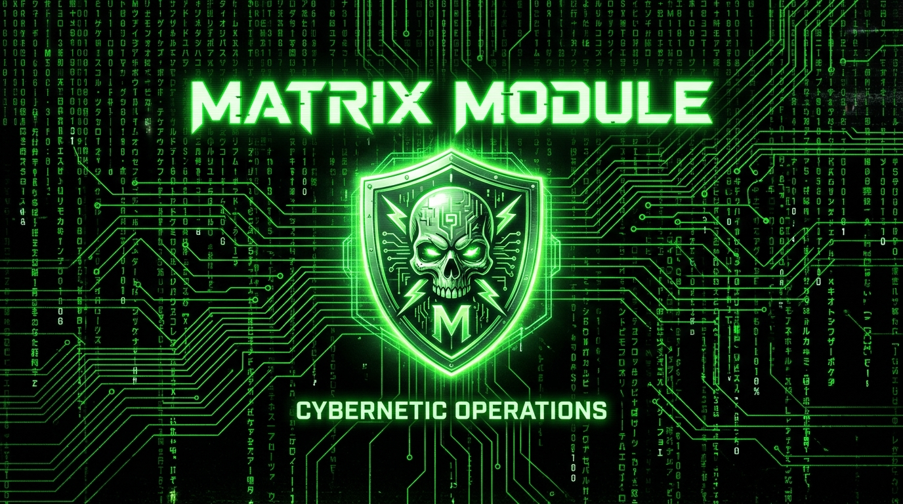
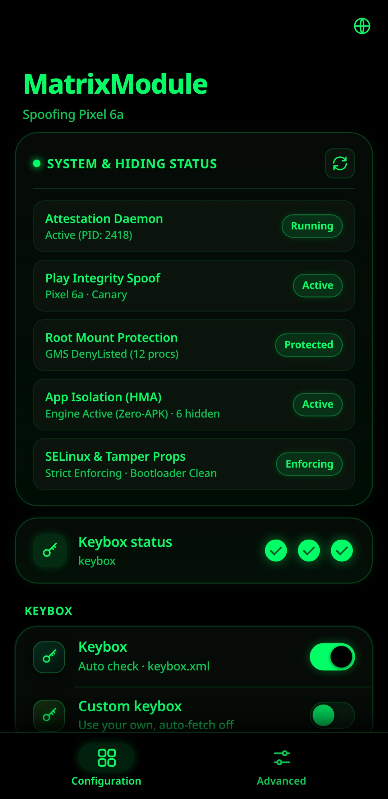
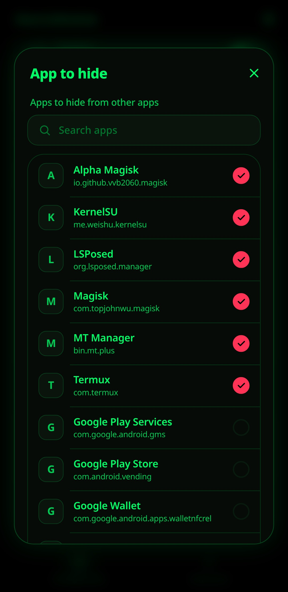
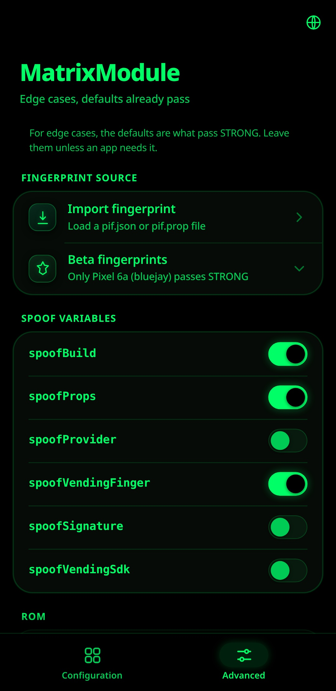
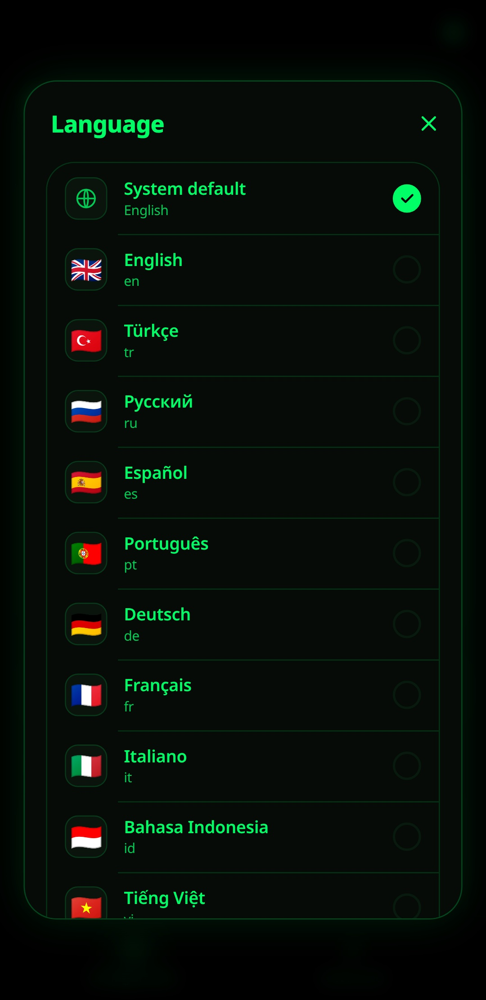
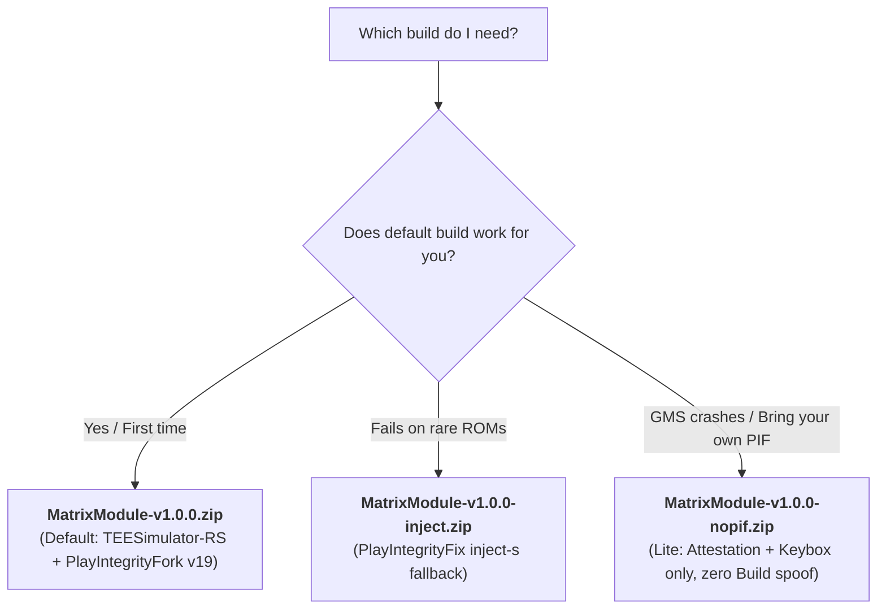

<div align="center">



<br><br>

[](LICENSE)
[](CHANGELOG.md)
[](https://android.com)
[](https://developer.android.com/google/play/integrity)
[](#-root-manager-compatibility)

<br>

### The All-In-One Root Cloaking & Hardware Attestation Suite for Android 10–16
**Hardware Keystore Attestation (`MEETS_STRONG_INTEGRITY`) &bull; Zero-APK Headless HMA Engine &bull; Dynamic Root-Grant DB Auto-Scanner &bull; Pitch-Black Cyber WebUI**

<br>

<p align="center">
   &nbsp;
   &nbsp;
   &nbsp;
  
</p>

<sub><b>Pitch-Black Cyber WebUI:</b> Live System Health Dashboard, Headless App Isolation, Granular PIF Controls, translated into 15 languages.</sub>

</div>

---

## ⚡ Why MatrixModule? ("Flash & Go to Sleep")

Tired of juggling 5 different modules, companion APKs, and broken keyboxes every weekend?  
**MatrixModule** consolidates everything into **ONE single, drop-in Zygisk module**. No duplicate folders. No Zygisk conflicts. No manual keybox hunting.

| The Old, Frustrating Way ❌ | The MatrixModule Way ⚡ ✅ |
|---|---|
| **Manual Root Hiding:** Hardcoding package names or manually toggling hidden apps in companion APKs. | **Dynamic Root-Grant DB Scanner:** Auto-extracts granted apps from KernelSU (`.allowlist`), Magisk (`magisk.db`), and APatch (`superkeys`). Any root app is masked on the fly! |
| **Offline Attestation Failure:** Flashing a module offline gives a revoked demo keybox on day 1. | **Day-1 Offline STRONG:** Ships with a bundled, unrevoked 4.9 KB ECDSA keybox seed (`module/keybox.xml`). Hits `STRONG` on first boot without internet! |
| **Upgrade Conflicts & Residue:** Stale pipes, orphaned sockets (`admin.sock`), and legacy folders causing boot issues. | **Pre-Flight Deep Clean:** Auto-sweeps legacy folders (`cleverestricky`, `teesim`), dead pipes, and purges bogus `update` flags. |
| **Fragile Keybox Downloads:** Fetchers hang indefinitely on Cloudflare 301 redirects or single host outages. | **Multi-Mirror Failover Engine:** Direct HTTPS primary (`evoker.qzz.io`) + GitHub raw fallback (`yurikey`) with 15s strict connect timeouts. |
| **Leaky Root Mounts:** Root mounts visible in `/proc/self/mountinfo` and leaky debuggable properties. | **Mount Namespace Isolation & Strict Prop Lock:** Unmounts root paths from target apps; locks production properties (`ro.debuggable=0`, `ro.secure=1`). |
| **Cluttered Manager:** 4–5 separate modules competing for Zygote hooks and eating RAM. | **Single Module Architecture:** Strictly lives under `tricky_store`. Zero ghost modules, <2.5 MB RAM footprint. |

---

## 💎 Core Highlights & Features

```
┌────────────────────────────────────────────────────────────────────────┐
│  🧠 Dynamic Root-Grant DB Auto-Scanner (Zero-Config Auto-Hide)        │
│  🛡️ Zero-APK Headless HMA Engine (Direct Zygote PMS Interception)      │
│  ⚡ Offline Day-1 STRONG Attestation (Bundled Unrevoked Keybox Seed)   │
│  🌐 Multi-Mirror Keybox Failover (Evoker HTTPS + Yurikey GitHub Raw)   │
│  🔒 Mount Namespace Isolation & Strict Security Property Locking       │
│  📟 Action Button 5-Point Progressive Visual Diagnostics               │
│  🎛️ Pitch-Black Cyber WebUI & Event-Driven Rust Inotify Watcher       │
└────────────────────────────────────────────────────────────────────────┘
```

### 1. 🧠 Dynamic Root-Grant DB Auto-Scanner (Zero-Config Auto-Hide)
No more manually searching for apps or typing package names into hiding lists:
- **Real-Time Database Querying:** Inspects KernelSU allowlists (`/data/adb/ksu/.allowlist`, `temp_grants.json`), Magisk SQLite policies (`/data/adb/magisk.db`), and APatch configs (`package_config`, `superkeys`).
- **Zero-Config Immunity:** The moment an app is granted root—even if it's renamed or has a randomized package name—MatrixModule dynamically detects it, merges it into `hidden_apps`, and hot-updates HMA's blacklist `appList`.
- **System Safeguards:** Core system packages (`android`, `system`, `com.android.*`) and Google Play services (`com.google.android.gms`, `gsf`, `vending`) are strictly safeguarded from accidental masking.

### 2. 🛡️ Zero-APK Headless App Isolation (HMA-OSS Engine)
- **Zero Companion APKs Required:** Hooks PMS directly from the Zygote layer without needing any companion manager APK installed on your device.
- **Deep App Data Isolation:** Applies `altAppDataIsolation`, `altVoldAppDataIsolation`, and `forceMountData` with real-time `status.json` sync (`workMode: 1`).
- **Protects Target Apps:** Banking, government, and payment apps can never query or detect root managers (Magisk, KernelSU, APatch, LSPosed, Termux, MT Manager, etc.).

### 3. ⚡ Offline Day-1 STRONG Attestation
- **Bundled Hardware Keybox:** Pre-packaged with an unrevoked 4.9 KB ECDSA hardware keybox directly bundled into `module/keybox.xml`.
- **Instant Out-of-the-Box Passing:** Passes `MEETS_STRONG_INTEGRITY` on the very first boot without requiring active Wi-Fi, mobile data, or initial internet setup.
- **Fail-Safe Guard:** The online keybox engine will never replace or overwrite your working keybox unless a downloaded candidate passes full XML and cryptographic validity checks.

### 4. 🌐 Multi-Mirror Keybox Failover Engine
- **Dual-Mirror Redundancy:**
  - **Primary Mirror:** Direct HTTPS endpoint (`https://evoker.qzz.io/key`) bypassing Cloudflare 301 HTTP-to-HTTPS redirect hangs.
  - **Secondary Mirror:** Direct GitHub raw mirror (`https://raw.githubusercontent.com/Yurii0307/yurikey/main/key`) for live Yurikey Base64 XML keybox failover.
- **Strict 15s Timeouts:** Enforces `-L` redirect-following and 15-second connect timeouts across all engines (`asfetch`, `busybox`, `curl`, `wget`).
- **Auto-FP Freeze Protection:** Automatically restores `auto_fp=1` if a custom PIF file is missing, preventing silent fingerprint rotation freeze.

### 5. 🔒 Mount Namespace Isolation & Strict Prop Locking
- **Kernel-Level Mount Unmounting:** Uses `nsenter -t $pid -m` to unmount `/data/adb`, `/data/adb/modules`, and debug ramdisk paths directly from target apps' `/proc/$pid/mountinfo`.
- **Hardened Property Lockdown:** Enforces production security properties:
  `ro.debuggable=0`, `ro.force.debuggable=0`, `ro.secure=1`, `ro.adb.secure=1`, `ro.build.type=user`, `ro.build.tags=release-keys`, `sys.oem_unlock_allowed=0`, `ro.boot.vbmeta.device_state=locked`, `ro.boot.verifiedbootstate=green`.

### 6. 📟 Action Button 5-Point Progressive Diagnostics
Tap the **[Action]** button in your root manager (or run `/data/adb/modules/tricky_store/action.sh` in terminal) to trigger a progressive, live 5-point audit:

```text
  =========================
  [*] Keybox Status: Valid (Source: Evoker / Yurikey / Built-in)
  [*] Fingerprint: Synced (2026-11-22)
  [*] Zygisk Host: Active
  [*] Root Hiding: HMA Engine Active (25 apps hidden, 4 granted root auto-detected)
  [*] Integrity Verdict: STRONG Ready
  =========================
  ✅ done
```

---

## 🚀 Installation Guide: Dead Simple 1-2-3

```
┌────────────────────────────────────────────────────────┐
│  Step 1: Install Zygisk Next or ReZygisk.             │
│  Step 2: Flash MatrixModule-v1.0.0.zip.                │
│  Step 3: Reboot & tap [Action] in your manager.        │
│                                                        │
│  Done! Open any Play Integrity Checker and smile. ✅   │
└────────────────────────────────────────────────────────┘
```

1. **Prerequisite:** Make sure your root manager has a working Zygisk module installed (**[Zygisk Next](https://github.com/Dr-TSNG/ZygiskNext)** or **[ReZygisk](https://github.com/PerformanC/ReZygisk)** recommended).
2. **Download:** Grab the latest `MatrixModule-v1.0.0.zip` from **[Releases](https://github.com/mengalpratik/MatrixModule/releases)**.
3. **Flash:** Install the ZIP in **KernelSU**, **APatch**, or **Magisk**, then **Reboot**.
4. **Activate:** Open your root manager and tap **[Action]** on MatrixModule (or run `su -c "/data/adb/modules/tricky_store/action.sh"` in Termux).
   - *On KernelSU / APatch, open the WebUI to inspect live health and toggles!*
5. **Verify:** Open any integrity checker (*Play Integrity API Checker*, *TB Checker*, or *Simple PIC*) &mdash; verify **STRONG PASS**!

---

## 📱 Root Manager Compatibility

MatrixModule is **100% root-agnostic**, rigorously tested across all modern Android root environments:

| Root Manager | Compatibility | Support Highlights |
|---|:---:|---|
| **KernelSU** | 🟢 Native | Full Pitch-Black WebUI, Zygisk Next / ReZygisk, kernel-level unmount, allowlist scanner. |
| **KernelSU Next** | 🟢 Native | Enhanced WebUI, dynamic module mounts, automatic app isolation sync. |
| **APatch** | 🟢 Native | SuperKey WebUI support, Zygisk Next / NeoZygisk, `package_config` grant scanner. |
| **APatch Next** | 🟢 Native | Enhanced binder hooking, mount namespace isolation, superkeys parsing. |
| **Magisk (Official)** | 🟢 Full | 1-Tap `Action` button bootstrap, standalone WebUI APK support, SQLite policy parsing. |
| **Magisk Alpha** | 🟢 Full | Native ash re-execution fallback, mksh-safe subshell execution. |
| **SukiSU Ultra** | 🟢 Full | Kernel-level hooking, WebUI integration, grant auto-discovery. |
| **Kitsune Mask** | 🟢 Full | MagiskHide / Sulist co-existence without dual-hook conflicts. |

> [!NOTE]
> **Android Version Support:** Android 10, 11, 12, 12L, 13, 14, 15, and Android 16.

---

## 📦 Which Build to Download?

Every release provides three tailored lines. **If you're not sure, grab the default:**



| Download Package | Play Integrity Engine | Hardware Keystore Engine | Best For |
|---|---|---|---|
| **`MatrixModule-v1.0.0.zip`** | **PlayIntegrityFork v19** (osm0sis) | **TEESimulator-RS** (Enginex0) | **Default — Start here.** 99% of users pass `STRONG` out of the box. |
| **`MatrixModule-v1.0.0-inject.zip`** | PlayIntegrityFix inject-s (KOWX712) | **TEESimulator-RS** (Enginex0) | Edge-case custom ROMs where Fork doesn't hit `STRONG`. |
| **`MatrixModule-v1.0.0-nopif.zip`** | *None (Lite)* | **TEESimulator-RS** (Enginex0) | Users wanting to run their own standalone PIF or fixing GMS crashes. |

<details>
<summary><b>🛠️ Optional Keystore Engines (TrickyStoreOSS & JingMatrix TEESimulator)</b></summary>

Alternative keystore backends are also supported for custom compilation:
- **TrickyStoreOSS (`-TSOSS`)**: Open-source keystore engine by beakthoven (`classes.dex` + `libinject.so`).
- **TEESimulator (`-TEESIM`)**: Original daemon by JingMatrix (`canary-76`).

Build locally using `./build.sh --engine trickystoreoss` or `./build.sh --engine teesim`. See [docs/ADVANCED.md](docs/ADVANCED.md).

</details>

---

## ☕ Support & Donations

Maintaining an all-in-one integrity and root cloaking suite against Google's weekly detection cat-and-mouse updates requires constant reverse engineering, testing, and countless cups of coffee.

If **MatrixModule** helped you pass Play Integrity, saved your banking apps, or spared your weekend:

<div align="center">

| 🌍 International | 🇮🇳 India (UPI) |
|:---:|:---:|
| <a href="https://buymeacoffee.com/pratikmengal" target="_blank"></a><br><br><b>[buymeacoffee.com/pratikmengal](https://buymeacoffee.com/pratikmengal)</b> | <br><br><b>UPI ID:</b> <code>iampratikmengal-2@okaxis</code><br><b>Name:</b> Pratik Mengal (Neuro) |

*Every contribution directly supports server mirrors, test devices, and future updates. Thank you! ❤️*

</div>

---

## 🏆 Hall of Fame & Credits

MatrixModule proudly builds upon the groundbreaking research of the Android open-source root & security community:

<div align="center">
  
</div>

- **[osm0sis](https://github.com/osm0sis)** &mdash; [PlayIntegrityFork](https://github.com/osm0sis/PlayIntegrityFork), actively maintained PIF engine.
- **[chiteroman](https://github.com/chiteroman)** &mdash; Creator of the original Play Integrity Fix.
- **[Enginex0](https://github.com/Enginex0)** &mdash; [TEESimulator-RS](https://github.com/Enginex0/TEESimulator-RS) (Rust port, native certgen, AOSP keystore attestation).
- **[JingMatrix](https://github.com/JingMatrix)** &mdash; Creator of the original TEESimulator, keystore2 IPC interception, and NeoZygisk.
- **[5ec1cff](https://github.com/5ec1cff)** &mdash; Pioneer of TrickyStore and the `/data/adb/tricky_store` architecture.
- **[beakthoven](https://github.com/beakthoven)** &mdash; [TrickyStoreOSS](https://github.com/beakthoven/TrickyStoreOSS), open-source keystore engine.
- **[frknkrc44](https://github.com/frknkrc44) & [Dr-TSNG](https://github.com/Dr-TSNG)** &mdash; [HMA-OSS](https://github.com/frknkrc44/HMA-OSS) (Hide My Applist) PMS hook engine.
- **[Evokerr](https://gitlab.com/Evokerr)** &mdash; [AlwaysStrong](https://gitlab.com/Evokerr/AlwaysStrong) core architecture and Play Integrity automation baseline.
- **[Yurii0307](https://github.com/Yurii0307)** &mdash; Creator of [Yurikey](https://github.com/Yurii0307/yurikey), providing the live failover keybox mirror and keybox distribution research.
- **[MeowDump](https://github.com/MeowDump)** &mdash; Creator of [Integrity-Box](https://github.com/MeowDump/Integrity-Box), pioneer of bootloader tamper-locking and security property unification.
- **[KOWX712](https://github.com/KOWX712)** &mdash; PlayIntegrityFix inject-s and KsuWebUIStandalone.
- **[Displax](https://github.com/Displax)** &mdash; SafetyNet Fix boot scripts.
- **[daboynb](https://github.com/daboynb)** &mdash; Playcurl & automated fingerprint refresh concepts.
- **[LSPlt](https://github.com/LSPosed/LSPlt)** & **[ring](https://github.com/briansmith/ring)** &mdash; Native PLT hooking and Rust cryptographic primitives.

**Author & Lead Maintainer:**  
**Pratik Mengal (Neuro)** &mdash; [@mengalpratik](https://github.com/mengalpratik)

---

## 📜 Copyright & License

Copyright &copy; 2026 **Pratik Mengal**. All rights reserved.

Distributed under the **GNU General Public License v3.0 (GPL-3.0)**. Bundles TEESimulator-RS (GPL-3.0) and HMA-OSS components (GPL-3.0). See [LICENSE](LICENSE) for full legal terms.

*Disclaimer: This module is intended for educational, privacy, and security research purposes. `STRONG` integrity requires a valid, non-revoked hardware keybox.*
