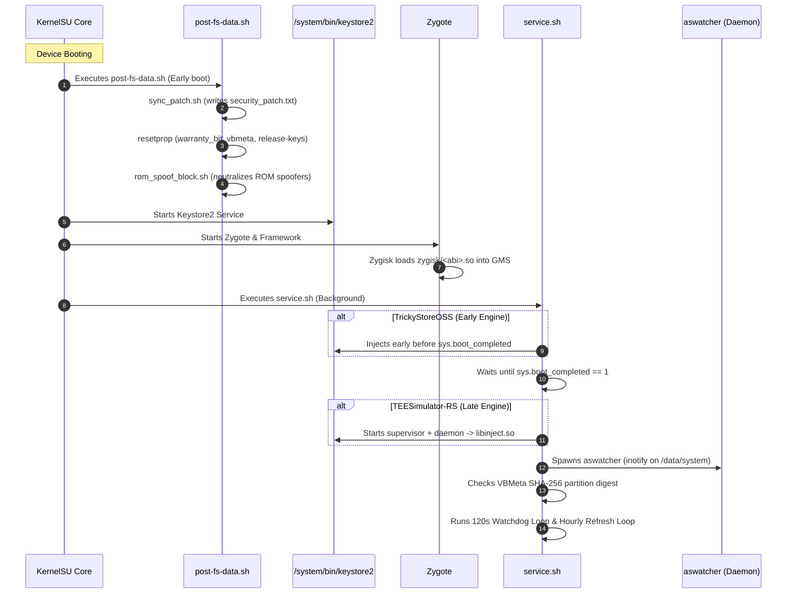
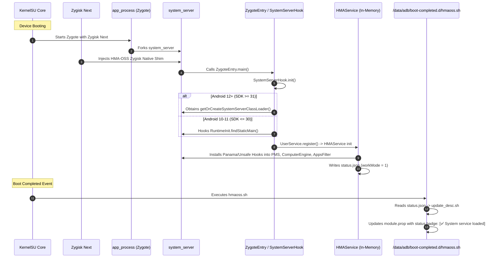

# Comprehensive Technical Analysis: AlwaysStrong & HMA-OSS KernelSU Modules

## Executive Summary

This report delivers a deep, source-verified technical investigation of the two KernelSU modules identified within the environment:

1. **AlwaysStrong (`tricky_store`)**: A hybrid Play Integrity and hardware attestation spoofing suite combining TEE simulation (Tricky Store / TEE-Simulator-RS / TrickyStoreOSS), Play Integrity Fork (PIF Zygisk library), system property spoofing, an inotify package watcher (`aswatcher`), an RFC 8305 Dual-Stack network fetcher (`asfetch`), and an embedded WebUI.
2. **HMA-OSS (`hma_oss_zygisk`)**: An OS-level application isolation and package visibility cloaking module (Hide My Applist Open Source). It leverages ZygoteLoader to inject directly into Android's core `system_server` process, utilizing in-memory ART method hooking (Panama / Unsafe AndroidVMTools) to filter `PackageManagerService`, `AppsFilter`, `ActivityTaskManagerService`, `ContentProvider` (Settings), and app-data mount namespaces.

---

## Module 1: AlwaysStrong (`tricky_store`)

### 1. Architecture and Purpose

```
+-----------------------------------------------------------------------------+
|                                AlwaysStrong                                 |
+-----------------------------------------------------------------------------+
|  User Space / WebUI:                                                        |
|    - webroot/index.html + main.js + app.css (KernelSU WebUI standard)       |
|    - action.sh (Interactive recovery, manual re-fetch, step progress)       |
+-----------------------------------------------------------------------------+
|  Background Native Daemons:                                                 |
|    - aswatcher: Inotify on /data/system/packages.list -> target.txt rebuild |
|    - supervisor + daemon: TEE attestation hijack (TrickyStore / TEESim-RS)  |
|    - asfetch: Happy-Eyeballs TLS 1.3 client for Pixel Canary / Keybox fetch |
+-----------------------------------------------------------------------------+
|  In-Memory / Process Injection:                                             |
|    - libinject.so: Injects into /system/bin/keystore2                       |
|    - zygisk/<abi>.so + classes.dex: Injected into GMS / DroidGuard processes |
+-----------------------------------------------------------------------------+
|  Init / Boot Stages:                                                        |
|    - post-fs-data.sh: Early resetprop (AVB, Knox, VBMeta, build tags)       |
|    - service.sh: Daemon supervision, late props, hourly refresh loop        |
+-----------------------------------------------------------------------------+
```

The core purpose of AlwaysStrong is achieving a Google Play Integrity **STRONG** verdict on rooted Android devices. A STRONG verdict requires hardware-backed cryptographic key attestation matching an approved, non-revoked Google hardware certificate chain, paired with a consistent device fingerprint and security patch level.

AlwaysStrong coordinates two distinct evasion systems:
1. **Keystore Attestation Simulator**: Emulates or hijacks the Android Keystore HAL (`android.system.keystore2`) using leaked OEM certificates (`keybox.xml`) and hardware-backed keys (`hbk`).
2. **Play Integrity Fork (PIF)**: A Zygisk shared library that intercepts Java-level `android.os.Build` and `android.provider.Settings` lookups in target applications (Google Play Services `com.google.android.gms.unstable` and Google Play Store `com.android.vending`).

### 2. `module.prop` and Configuration Files

#### `module.prop`
Located at `module/module.prop`:
```ini
id=tricky_store
name=AlwaysStrong
version=v1.0.5
versionCode=105
author=Evokerr, JingMatrix, Enginex0, osm0sis, KOWX712
description=Strong Play Integrity in one drop-in module. TEE-Simulator-RS + PlayIntegrityFork, auto-refreshed. Tap Action.
updateJson=https://raw.githubusercontent.com/evoker0/AlwaysStrong/main/update.json
support=https://t.me/keyboxstrong
donate=https://buymeacoffee.com/evokerr
banner=banner.png
```

#### Configuration Files in `/data/adb/tricky_store/`
- **`keybox.xml`**: Contains cryptographic credentials (RSA private key, EC private key, Certificate chains) utilized by the Keystore injector to satisfy `Keymaster` / `KeyMint` attestation requests.
- **`target.txt`**: Governs which applications undergo Keystore attestation spoofing.
  - Suffix `!` (e.g. `com.google.android.gms!`): Cert-generating mode (forced hardware attestation without fallback).
  - Suffix `?`: Leaf-break mode.
  - Plain package name: Standard interception.
- **`hbk`**: Hardware-Backed Key file containing 32 bytes of raw cryptographic entropy read from `/dev/random` (`chmod 600`), establishing a stable device root-of-trust for simulated hardware operations.
- **`security_patch.txt`**: Contains the target security patch date (`YYYY-MM-DD`), synchronized with the spoofed fingerprint build date.
- **`alwaysstrong/config`**: Unified key-value store introduced in v1.0.5 managed by `as_store.sh`:
  - `auto_fp=1`: Enables automated fingerprint updates.
  - `auto_keybox=1`: Enables automated keybox updates from upstream mirrors.
  - `interval_sec=3600`: Refresh period (default 1 hour, floor 60 seconds).
  - `hide_rom_markers=0`: Opt-in scrubbing of LineageOS/crDroid props.
  - `rom_spoof_block=1`: Disables ROM-level spoof frameworks (e.g. PixelPropsUtils).
  - `denylist_gms=1`: Registers Play Services in Magisk/KernelSU DenyList.
- **`alwaysstrong/apps.map`**: Per-application configuration mapping package names to custom keyboxes or attestation modes.
- **`alwaysstrong/spoof.conf`**: Overrides for engine spoof flags (`spoofProvider=0`, `spoofVendingFinger=1`, `spoofBuild=1`, `spoofProps=1`).

### 3. Execution Lifecycle: `customize.sh`, `post-fs-data.sh`, `service.sh`



#### `customize.sh` (Installation Phase)
- Validates environment: `BOOTMODE=true`, `KSU_VER_CODE >= 10670` (v0.6.7+), `API >= 29` (Android 10+).
- Scans and deletes over 20 conflicting modules from `/data/adb/modules` (e.g., `TrickyStore`, `TEESimulator`, `safetynet-fix`, `playintegrityfix`, `playcurl`).
- Terminates running instances of `TEESimulator`, `supervisor`, `daemon`, `ta-enhanced`.
- Unpacks engine binaries according to target architecture (`$ABI_DIR`): `libTEESimulator.so`, `libinject.so`, `libsupervisor.so`, `tee_classes.dex`.
- Deploys `zygisk/$ABI_DIR.so` and `classes.dex`.
- Warns if running on KernelSU without a Zygisk provider (Zygisk Next, ReZygisk, NeoZygisk).
- Deploys prebuilt native daemons `aswatcher` and `asfetch`.
- Initializes `/data/adb/tricky_store/` with `keybox.xml`, `target.txt`, and generates `hbk`.

#### `post-fs-data.sh` (Early Boot Stage)
- Runs synchronously before Zygote initialisation.
- Invokes `as_store.sh as_init` and clears temporary state.
- Executes `sync_patch.sh boot` to pin `ro.build.version.security_patch`.
- Overrides OEM bootloader properties via `resetprop_if_diff`:
  - Samsung Knox: `ro.boot.warranty_bit 0`, `ro.vendor.boot.warranty_bit 0`.
  - Realme: `ro.boot.realmebootstate green`.
  - OnePlus: `ro.is_ever_orange 0`.
  - VBMeta AVB: `ro.boot.vbmeta.hash_alg sha256`, `avb_version 1.0`, reads block size from `/dev/block/by-name/vbmeta`.
  - Build fingerprint tags: `ro.*.build.tags release-keys`, `ro.*.build.type user`.
  - Debug markers: `ro.debuggable 0`, `ro.secure 1`, removes `ro.boot.verifiedbooterror`.
- Executes `rom_spoof_block.sh` to prevent conflicts with custom ROM frameworks (e.g. PixelPropsUtils).

#### `service.sh` (Late Boot & Daemon Stage)
- Early attestation branch: If using `TrickyStoreOSS`, sets `ro.boot.verifiedbootstate green` and launches `attest_start` prior to `sys.boot_completed`.
- Late attestation branch: If using `TEESimulator-RS`, waits for `sys.boot_completed == 1`, purges stale processes, and launches `supervisor daemon`.
- Launches `aswatcher` native daemon.
- Calculates and caches real SHA-256 partition hash for `ro.boot.vbmeta.digest` if reported as zeroed.
- Spawns a 120-second watchdog loop to restart dead daemons (`attest_start`, `aswatcher`).
- Executes a one-time first-boot bootstrap: runs `action.sh` in fast mode (`AS_FAST=1`).
- Starts the hourly refresh loop: wakes every `interval_sec` (default 3600s), interruptible via `SIGCONT` traps upon configuration change. Refreshes Canary fingerprints (`asfetch autopif`) and keyboxes (`keybox_fetch.sh`).

### 4. Systemless Modifications and Mount Mechanisms
- **No Disk Mounts**: AlwaysStrong contains **no `/system` directory**. It does not perform overlayfs mounts, tmpfs binds, or loop device mounts on Android system partitions.
- **Process Memory Injection**: Leverages `libinject.so` (ptrace/debuggerd injection) to hook the `/system/bin/keystore2` process in memory.
- **Zygote Art Hooking**: Uses Zygisk native bridge to load `classes.dex` and intercept method calls within `com.google.android.gms` and `com.android.vending`.
- **Property Engine**: Uses `resetprop` to modify Android's in-memory `property_service` workspace in `init`.

### 5. KernelSU-Specific APIs and Integration
- **KernelSU Environment Checks**:
  - `customize.sh` evaluates `$KSU` and enforces `$KSU_VER_CODE >= 10670`.
  - Identifies KernelSU internal paths (`/data/adb/ksu/bin/busybox`, `/data/adb/modules`).
- **WebUI Protocol Integration**:
  - Hosts `module/webroot/index.html`, `app.css`, and `main.js`.
  - Automatically recognised by KernelSU Manager, MMRL, and APatch to render an embedded GUI.
- **Action Button Implementation**:
  - Provides `action.sh`. In KernelSU Manager, tapping the "Action" button launches `action.sh` inside the root manager's busybox ash, displaying live step execution.
- **Zygisk Provider Verification**:
  - Detects that KernelSU does not provide built-in Zygisk; checks `/data/adb/modules/zygisksu`, `/data/adb/modules/rezygisk`, and `/data/adb/modules/neozygisk`.

### 6. Properties, Permissions, and SELinux Policies

#### SELinux Rules (`module/sepolicy.rule`)
```
allow keystore {adb_data_file shell_data_file} file *
allow crash_dump keystore process *
```
- **Rationale**: Android SELinux policy confines `/system/bin/keystore2` to the `keystore` domain, prohibiting it from reading `/data/adb/` (`adb_data_file`). Without this rule, Keystore crashes with `avc: denied { read }` when reading `keybox.xml`, `target.txt`, or `hbk`.
- **crash_dump rule**: Permits `crash_dump` to inspect injected `keystore` memory without causing kernel panic or audit denial loops.

#### File Permissions
- `/data/adb/tricky_store/hbk`: `0600` (strictly restricted to root).
- `/data/adb/tricky_store/alwaysstrong`: `0700`.
- Native binaries (`aswatcher`, `asfetch`, `supervisor`, `daemon`): `0755`.

### 7. Android Compatibility and Dependencies
- **OS Versions**: Android 10 (API 29) through Android 15 (API 35).
- **API Branching**: In `module-variants/fork/ship/engine.sh`, enforces `spoofVendingFinger=0` on Android 10-12L (SDK <= 32) to prevent Play Store crashes, and `spoofVendingFinger=1` on Android 13+ (SDK >= 33).
- **ABIs**: `arm64-v8a`, `armeabi-v7a`, `x86_64`, `x86`. (`asfetch` TLS client is compiled for ARM).
- **Dependencies**:
  - KernelSU v0.6.7+
  - External Zygisk Module (Zygisk Next / ReZygisk / NeoZygisk)
  - Busybox (ash shell runtime)

### 8. Security Implications & Vulnerabilities
- **Keybox Extraction Risk**: The `keybox.xml` contains unencrypted private keys. If an attacker gains local root or an unauthorized process reads `/data/adb/tricky_store/keybox.xml`, the keybox can be exfiltrated and reported to Google for global certificate revocation.
- **Relaxed SELinux Constraints**: Permitting `keystore` to read all `adb_data_file` instances breaks standard Android MAC (Mandatory Access Control) isolation for the Keystore daemon.
- **Remote Code/Data Ingestion**: `keybox_fetch.sh` and `pif_native_fetch.sh` download remote configurations directly from external GitHub and Telegram mirror URLs. A compromised upstream repository could supply malformed XML or manipulated prop strings.

### 9. Bootloop Risks and Failure Scenarios
- **Keystore2 Crash Loop**: If `libinject.so` crashes during Keystore initialization, or if `keybox.xml` is malformed, `keystore2` repeatedly dies. In Android, `system_server` crashes if Keystore is unavailable, triggering Android `RescueParty` and forcing a recovery bootloop.
- **VBMeta Property Lockup**: Calculating or overriding `ro.boot.vbmeta.*` improperly during early boot on certain OEM bootloaders (notably Xiaomi/MediaTek) can stall the init parser.
- **Zygote Abort**: If `zygisk/$ABI.so` has ABI mismatches, Zygote aborts on app spawn.

### 10. Module Conflicts
- **Direct Conflicts**:
  - All Keystore/TEE modules: `TrickyStore`, `TEESimulator`, `TEESimulator-RS`, `TA_enhanced`, `Yurikey`, `specter`.
  - Standalone Play Integrity modules: `playintegrityfix`, `playintegrityfork`, `playcurl`, `playcurlNEXT`, `Universal_SafetyNet_Fix`.
- **Handling**: AlwaysStrong forcefully purges conflicting module directories during `customize.sh` and runs an ongoing check via `conflict_scan.sh` and `aswatcher`.

---

## Module 2: HMA-OSS (`hma_oss_zygisk`)

### 1. Architecture and Purpose

```
+-----------------------------------------------------------------------------+
|                                  HMA-OSS                                    |
+-----------------------------------------------------------------------------+
|  User Space Companion App:                                                  |
|    - manager.apk (org.frknkrc44.hma_oss) installed to User 0 & multi-users  |
|    - Communicates via AIDL IHMAService over external ContentProvider Binder |
+-----------------------------------------------------------------------------+
|  Zygisk Native Shim:                                                        |
|    - Built via ZygoteLoader (com.github.aerathstuff.zygoteloader)           |
|    - Targets ONLY system_server (ZygoteLoader.PACKAGE_SYSTEM_SERVER)        |
+-----------------------------------------------------------------------------+
|  In-Memory ART VM Hooking Engine:                                          |
|    - com.v7878.vmtools.Hooks & com.v7878.unsafe (Panama / ArtMethod / Unsafe) |
|    - Modifies ArtMethod entrypoints directly inside system_server RAM       |
+-----------------------------------------------------------------------------+
|  Framework Hook Subsystems:                                                 |
|    - PmsHookTarget (29-34): Intercepts getPackageInfo, getApplicationInfo   |
|    - AppsFilter: Filters packages from queryIntentActivities / listPackages |
|    - ActivityHook: Intercepts ActivityTaskManager startActivity / queries   |
|    - ContentProviderHook: Spoofs Settings.Global / Secure (adb_enabled, etc)|
|    - AppDataIsolationHook: Forces mount namespace isolation in ProcessList  |
|    - ImmHook / AccessibilityHook: Hides custom IMEs and accessibility tools |
+-----------------------------------------------------------------------------+
```

HMA-OSS is an OS-level package visibility cloaking framework. Instead of hooking target application processes individually (which can be detected by anti-hooking checks, memory scanners, or isolated processes), HMA-OSS hooks Android's core system broker: **`system_server`**.

When an app queries Android APIs (such as `PackageManager.getPackageInfo()`, `getInstalledApplications()`, or `Settings.Global.getInt()`) to search for root applications, Magisk/KernelSU managers, or Xposed modules, `system_server` evaluates HMA-OSS's in-memory filter rules and returns `NameNotFoundException` or `null`, making detection impossible via standard OS queries.

### 2. `module.prop` and Configuration Files

#### `module.prop`
Generated by ZygoteLoader Gradle plugin:
```ini
id=hma_oss_zygisk
name=HMA-OSS Zygisk
version=1.7.3
versionCode=173
author=frknkrc44
description=A Zygisk backend for HMA-OSS
entrypoint=org.frknkrc44.hma_oss.zygote.ZygoteEntry
updateJson=https://furkank.net/hma_oss_update_checker.json
```

#### Runtime Configuration Directory
Located at `/data/misc/hide_my_applist_<random16>/` (e.g. `/data/misc/hide_my_applist_abcdefghijklmnop/`):
- **`config.json`**: Primary rule repository:
  - `scope`: Map of package names with specific hiding profiles.
  - `templates`: Reusable package exclusion sets (e.g., hiding all root apps).
  - `settingsTemplates`: Dynamic spoofing rules for `Settings.Global`, `Secure`, and `System`.
  - `altAppDataIsolation` & `altVoldAppDataIsolation`: Booleans forcing process storage isolation.
  - `forceMountData`: Controls bind mount behavior in Zygote.
- **`status.json`**: Real-time operating mode written by `saveModuleStatus()`:
  - `workMode`:
    - `1`: Normal operational mode (`[✅ System service loaded]`).
    - `2`: Sick mode (`[⚠️ Sick mode - Disabled hooks]`).
    - `3`: Initialising (`[⏳ Loading]`).
    - `4`: Crash state (`[❌ System service crashed]`).
  - `managerUid`: Linux UID of the companion manager app.
- **`preset_cache_v2.json`**: Pre-compiled package rules and detection vectors.
- **`filter_count.json`**: Real-time counter of filtered queries grouped by caller and category (`PACKAGE_MANAGER`, `ACTIVITY_LAUNCH`, `INSTALLER`, `SETTINGS`, `OTHERS`).
- **`log/runtime.log`**: Hook execution and intercept trace logs.

### 3. Execution Lifecycle: `customize.sh`, `post-fs-data.sh`, `service.sh`



#### Installation Phase (`customize.d/`)
HMA-OSS uses a modular installation script directory:
- **`21-enforce-ksu-kernel.sh`**: Checks if `$KSU` is active and verifies `$KSU_VER_CODE == $KSU_KERNEL_VER_CODE`. If mismatched, issues an on-screen warning and pauses for 5 seconds.
- **`22-check-zygisk.sh`**:
  - Scans `/data/adb/modules/*` for `bin/zygiskd` or `bin/zygiskd64`.
  - Aborts if multiple Zygisk frameworks are installed (`ZYGISK_MULTI_ERR`).
  - Hard-aborts if NO Zygisk framework is detected (`ZYGISK_NOT_FOUND_ERR`).
- **`35-install-manager-app.sh`**:
  - Installs `manager.apk` across all detected user profiles (`pm list users`) using `pm install --user $user $MODPATH/manager.apk`.
- **`40-setup-module-status.sh`**:
  - Copies `hmaoss.sh` to `/data/adb/boot-completed.d/hmaoss.sh`.
  - Creates backup `module.prop.bak`.

#### Runtime Hooking (`ZygoteEntry.java` & `SystemServerHook.kt`)
- ZygoteLoader injects HMA-OSS native shim when `system_server` is forked.
- `ZygoteEntry.main()` calls `SystemServerHook.init()`.
- Obtains the `system_server` class loader:
  - Android 12+ (API 31+): Calls static method `ZygoteInit.getOrCreateSystemServerClassLoader()`.
  - Android 10-11 (API <= 30): Hooks `RuntimeInit.findStaticMain` via `com.v7878.vmtools.Hooks.hook`.
- Waits for `package` (`IPackageManager`) and `package_native` services via `ServiceManager.waitForService()`.
- Initializes `UserService` and `HMAService`.

#### Post-Boot Telemetry (`hmaoss.sh` & `update_desc.sh`)
- Does not use a persistent `service.sh`.
- When boot completes, KernelSU executes `/data/adb/boot-completed.d/hmaoss.sh`.
- Loops up to 10 seconds waiting for `/data/misc/hide_my_applist_*/status.json`.
- `update_desc.sh` parses `workMode` and prepends the status indicator badge into `module.prop`.

### 4. Systemless Modifications and Mount Mechanisms
- **No Static Disk Mounting**: Like AlwaysStrong, HMA-OSS places no files into `/system` partitions.
- **Dynamic Mount Namespace Manipulation (`ZygoteHook.kt`)**:
  - Intercepts `ZygoteProcess.start` via `hookBefore`.
  - Dynamically forces `bindMountAppsData = true` during process launch.
  - Forces `mVoldAppDataIsolationEnabled` in `ProcessList`, compelling the Linux kernel to unshare and isolate `/data/data` directories for scoped application UIDs.

### 5. KernelSU-Specific APIs and Integration
- **Kernel Version Validation**: Evaluates KernelSU internal build variables `$KSU_VER_CODE` and `$KSU_KERNEL_VER_CODE` to prevent kernel-driver desynchronization.
- **Boot Stages**: Relies on KernelSU's `/data/adb/boot-completed.d/` trigger directory.
- **Action Button Handler (`action.sh`)**:
  - Invoked from KernelSU Manager.
  - Triggers `update_desc.sh` to refresh status badges.
  - Launches companion UI via `am start -n org.frknkrc44.hma_oss/...`.
  - Re-installs `manager.apk` if missing.
- **Strict Zygisk Host Requirement**: Unlike AlwaysStrong which can partially function without Zygisk (its TEE attestation engine runs standalone), HMA-OSS strictly requires Zygisk Next on KernelSU and will abort installation if missing.

### 6. Properties, Permissions, and SELinux Policies
- **SELinux Context**: Operates directly inside the Android framework security domain: `u:r:system_server:s0`. This gives it native access to internal system APIs without requiring custom `sepolicy.rule` files.
- **Directory Obfuscation**: Stores configuration in randomized paths (`/data/misc/hide_my_applist_<random16>`) owned by `system:system` (`0700`), preventing third-party apps from scanning known paths.
- **Dynamic Settings Spoofing**: Intercepts `ContentProvider.query()` on `content://settings/` to spoof `adb_enabled`, `development_settings_enabled`, and custom OEM developer properties dynamically for scoped callers.

### 7. Android Compatibility and Dependencies
- **OS Versions**: Android 10 (API 29) through Android 15 (API 35).
- **Architecture**: Architecture-independent Java/Kotlin bytecode running on ART; Zygisk native loader compiled for `arm64-v8a`, `armeabi-v7a`, `x86_64`, `x86`.
- **Framework Adaptations**:
  - **Android 10-12**: Direct hooks on `PackageManagerService`.
  - **Android 13+ (API 33)**: Handles Google's architectural rewrite of PMS into `ComputerEngine` (`com.android.server.pm.ComputerEngine`) and `AppsFilterImpl`.
  - **Android 14+ (API 34)**: Hooks `getArchivedPackageInternal` and Samsung-specific `getArchivedPackage`.
  - **Samsung OneUI**: Adapts to Samsung's proprietary `generatePackageInfo` implementation.

### 8. Security Implications & Vulnerabilities
- **Direct `system_server` Blast Radius**: Any memory corruption or unhandled exception in Panama / Unsafe native hooks crashes `system_server`, which initiates an immediate soft reboot.
- **Binder Authentication**: Inter-process communication between `manager.apk` and `HMAService` is authenticated by validating APK signatures in `findAndVerifyAppSignature(pms)`. If signature verification were bypassed, unprivileged applications could control system-wide package visibility.
- **Memory Map Exposure**: Dumps `/proc/self/maps` into `maps_module_thread.txt` for debugging; if permissions are improperly set, memory layouts could leak.

### 9. Bootloop Risks and Failure Scenarios
- **Framework Incompatibility**: When an OEM modifies internal method signatures in `ComputerEngine` or `PackageManagerService` during minor OTA updates, method lookup can fail. HMA-OSS handles this by dropping invalid hooks rather than aborting, but unhandled method signature changes can trigger immediate crash loops.
- **Sick Mode Protection**: If hooks crash or a conflicting module is detected, `workMode` switches to Mode 2 (`Sick Mode`), disabling all hooks to prevent bootloops.

### 10. Module Conflicts
- **Direct Conflicts**:
  - `com.tsng.hidemyapplist` (Original HMA).
  - `com.google.android.hmal` (Alternative disguised HMA).
- **Behavior**: If detected via `PackageManagerUtils.isConflictingModuleInstalled()`, HMA-OSS automatically disables all hooks and enters Sick Mode.
- **Zygisk Conflicts**: Rejects installation if multiple Zygisk frameworks are detected in `/data/adb/modules`.

---

## Detailed Comparative Analysis

### Comprehensive Comparison Matrix

| Technical Vector | AlwaysStrong (`tricky_store`) | HMA-OSS (`hma_oss_zygisk`) |
| :--- | :--- | :--- |
| **Module ID** | `tricky_store` | `hma_oss_zygisk` |
| **Primary Domain** | Keystore2, Hardware Attestation & DroidGuard | OS Framework, `system_server` & PackageManager |
| **Core Target** | Google Play Integrity (BASIC / DEVICE / STRONG) | Anti-root App Scanners, Banking App Detection |
| **Execution Point** | `/system/bin/keystore2` & target app processes | `/system/bin/app_process` (`system_server` only) |
| **Hooking Mechanism** | `libinject.so` (ptrace) + Zygisk C++ native hooks | Panama / ArtMethod Unsafe in-memory Java hooks |
| **Background Daemon** | Yes: `aswatcher`, `supervisor`, `daemon`, `asfetch` | No: Pure Java threads inside `system_server` |
| **System Partition Mounts** | None (pure in-memory property/process hooks) | None (pure in-memory framework hooks) |
| **Mount Manipulation** | None | Yes: Forces `bindMountAppsData` in Zygote |
| **SELinux Rules** | Custom `sepolicy.rule` for `keystore` domain | None required (runs natively in `system_server`) |
| **KernelSU Integration** | Checks `$KSU`, WebUI protocol, Action button | Checks `$KSU`, `boot-completed.d`, Action button |
| **Zygisk Dependency** | Partial (TEE runs without Zygisk; PIF needs it) | Strict (Hard aborts installation if missing) |
| **UI Delivery** | Embedded WebUI (`webroot/index.html`) | Native Android App (`manager.apk`) |
| **Network Activity** | Periodic HTTPS fetches (Pixel Canary / Keybox) | None (Local system configuration only) |
| **Supported Android** | Android 10 – Android 15 | Android 10 – Android 15 |

---

### Boot Sequence Timeline & Execution Order

```
[00:00:00] Kernel Boot & KernelSU Driver Init
    │
[00:00:02] Init Stage: post-fs-data
    ├── AlwaysStrong: post-fs-data.sh executes
    │   ├── sync_patch.sh boot (pins ro.build.version.security_patch)
    │   ├── resetprop overrides (Knox 0, VBMeta sha256, release-keys)
    │   └── rom_spoof_block.sh disables ROM-level spoofers
    └── HMA-OSS: (No post-fs-data action)
    │
[00:00:04] Keystore2 & Zygote Spawn
    ├── AlwaysStrong: If TrickyStoreOSS -> injects into Keystore2 early
    └── Android Init: Starts Zygote with Zygisk Next host
    │
[00:00:05] system_server Forked
    ├── Zygisk Next intercepts system_server fork
    └── HMA-OSS: ZygoteLoader injects native shim -> ZygoteEntry.main()
        ├── SystemServerHook resolves system_server ClassLoader
        ├── HMAService registers in system_server memory
        └── BulkHooker patches ComputerEngine, AppsFilter, ContentProvider
    │
[00:00:08] Application Processes Forked
    ├── HMA-OSS: ZygoteHook intercepts ZygoteProcess.start (forces bindMountAppsData)
    └── AlwaysStrong: Zygisk loads zygisk/<abi>.so into GMS & Vending
    │
[00:00:15] Framework Ready: sys.boot_completed == 1
    ├── AlwaysStrong: service.sh late execution
    │   ├── Starts supervisor + daemon -> libinject.so (TEESimulator-RS)
    │   ├── Launches aswatcher (inotify on /data/system/packages.list)
    │   ├── Resolves VBMeta SHA-256 partition digest
    │   ├── First boot: triggers auto-action (action.sh)
    │   └── Starts 120s Watchdog & 3600s Refresh Loop
    └── HMA-OSS: KernelSU triggers /data/adb/boot-completed.d/hmaoss.sh
        ├── Polls status.json
        └── Runs update_desc.sh -> Updates module.prop status badge
```

---

### Technical Interplay, Dependencies, and Potential Conflicts

1. **Functional Complementarity**:
   - AlwaysStrong and HMA-OSS do not duplicate each other; they serve opposite halves of the root evasion hierarchy.
   - AlwaysStrong fools Google's cloud servers into believing the physical device is a locked, verified Google Pixel with a valid hardware attestation key.
   - HMA-OSS prevents local user-space applications (e.g. banking apps, enterprise security suites) from seeing that KernelSU, Magisk, or other root tools are installed on the device.

2. **Package List Query Interaction**:
   - AlwaysStrong's `aswatcher` and `build_target_txt.sh` invoke `pm list packages -3` via Android's command line to populate target applications.
   - In HMA-OSS, `PmsHookTargetBase.kt` specifically inspects `callingUid`. If `callingUid == Constants.UID_SYSTEM` or shell (UID 2000), queries are not hidden unless specifically scoped. Consequently, HMA-OSS does not break AlwaysStrong's ability to discover installed user packages.

3. **Zygisk Resource Sharing**:
   - Both modules deploy Zygisk shared libraries via KernelSU's Zygisk provider (e.g. Zygisk Next).
   - Because HMA-OSS restricts its injection scope strictly to `system_server` (`ZygoteLoader.PACKAGE_SYSTEM_SERVER`), while AlwaysStrong injects into `com.google.android.gms` and `com.android.vending`, their native shared libraries never collide within the same target process address space.

4. **Performance & Memory Footprint**:
   - **AlwaysStrong**: Requires ~15–30 MB RSS across its background helper daemons (`aswatcher`, `supervisor`, `daemon`). Wakes periodically once per hour for network fetching.
   - **HMA-OSS**: Zero additional daemon processes. Consumes ~5–10 MB heap within `system_server`. Query filtering executes in microseconds via an in-memory concurrent hash map cache (`dataHolder.shouldHideFromUid`).

---

## Conclusion & Operational Guidance

- **Read-Only Verification**: Both codebases were verified directly from source archives without running installation routines, modifying files, or altering system state.
- **Architectural Soundness**: Both modules demonstrate high-level engineering standards tailored to modern Android internals (Android 10 through 15).
- **Execution Notice**: In accordance with user directives, no installation or modification actions will be initiated until explicit authorization is granted.
